<div align="center">

# ⚡ ZipZap

### The logistics operating system a courier business actually runs on

**Merchant ordering → pickup → two hubs → line-haul → last mile → cash → settlement**
in one deployable, with five surfaces reading one event stream.

<br/>

[](LICENSE)
[](https://www.typescriptlang.org/)
[](https://nestjs.com)
[](https://www.postgresql.org/)
[](https://react.dev)
[](https://nats.io)
[](https://pnpm.io)

</div>

<div align="center">

_Cash-on-delivery, where the courier holds the customer's money in trust and the money is the risk._

<table>
<tr>
<td width="33%">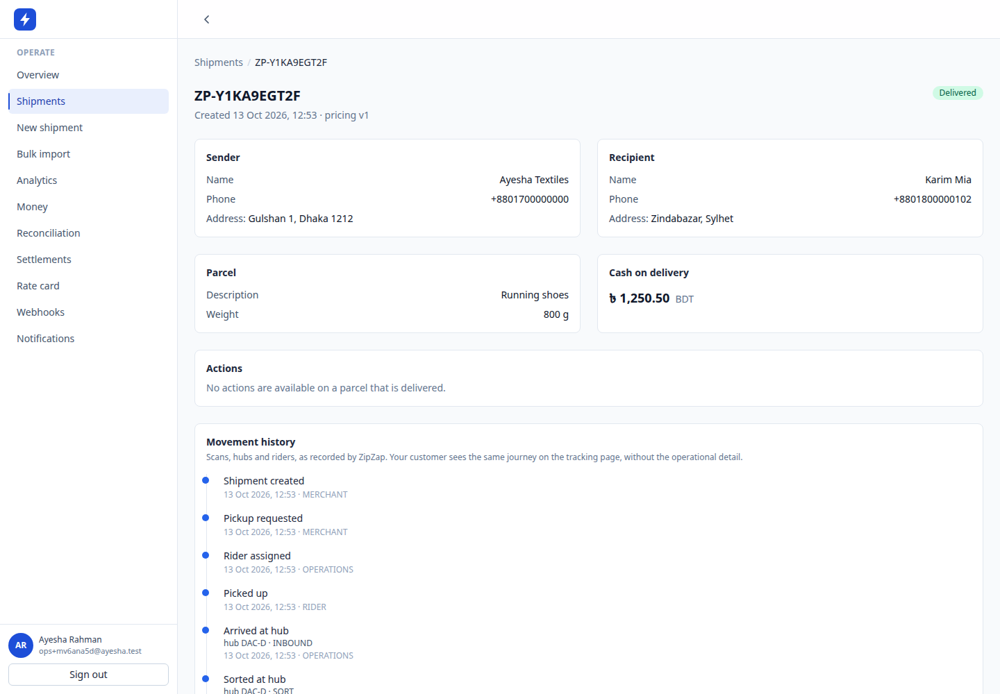</td>
<td width="33%">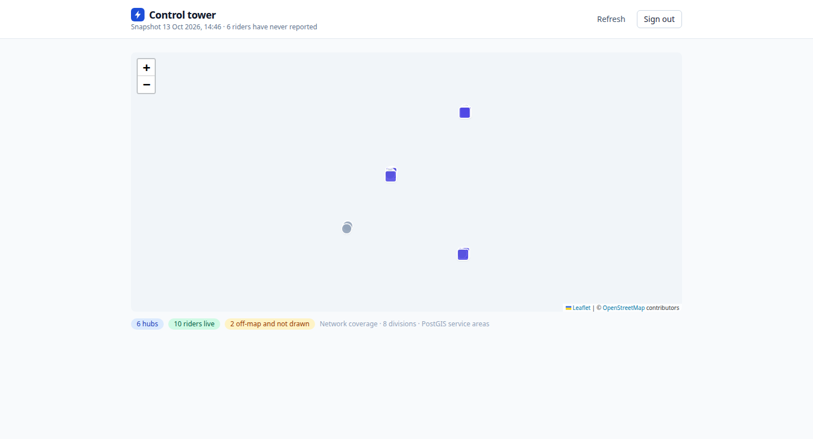</td>
<td width="33%">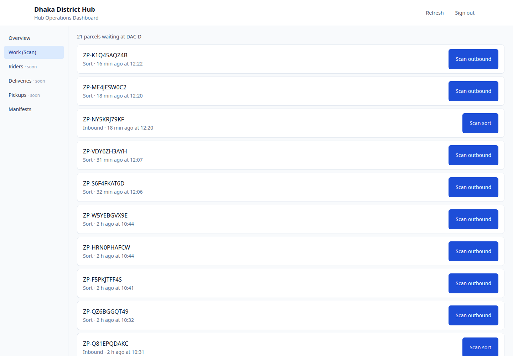</td>
</tr>
<tr>
<td align="center"><sub><b>Merchant</b> · the twelve-step journey of one parcel</sub></td>
<td align="center"><sub><b>Operations</b> · the network, live</sub></td>
<td align="center"><sub><b>Hub</b> · one parcel, one gesture</sub></td>
</tr>
</table>

</div>

---

## 📖 Contents

|                                 |                               |                              |                                |
| ------------------------------- | ----------------------------- | ---------------------------- | ------------------------------ |
| [Why this exists](#why)         | [Run it](#run)                | [The end-to-end flow](#flow) | [Architecture](#architecture)  |
| [How an event travels](#events) | [The money rules](#money)     | [Technology](#stack)         | [What proves it works](#proof) |
| [Surfaces](#surfaces)           | [Every screen](#every-screen) | [Documentation](#docs)       | [Not built](#not-built)        |

<a id="why"></a>

## 🎯 Why this exists

Not a parcel tracker — a parcel tracker is a lookup box. This is the internal operating platform of
a courier business: the thing a merchant, a rider, a hub operator and a finance team all work inside
of, every day, to move a box from a shop door to a customer's hand and get the money back.

It exists for two reasons.

**The product reason.** Cash-on-delivery is most orders in this market. The courier holds the
customer's money in trust from the moment a parcel is handed over, reconciles it against what was
quoted, and pays it out once the merchant has settled. That is the whole business, and it is where
the risk lives: a system that treats cash as an afterthought is one lost parcel away from an
unrecoverable one. ZipZap models the money as carefully as it models the transport.

**The engineering reason.** The interesting problem is simultaneity. One parcel scan has to appear at
that instant in five places — the merchant's detail view, the operations control tower, the hub's
work list, the customer's public tracking page, and the financial dashboard — and **none of those
five may read another's tables.** That constraint is the whole design, and it is the thing this
repository is a demonstration of.

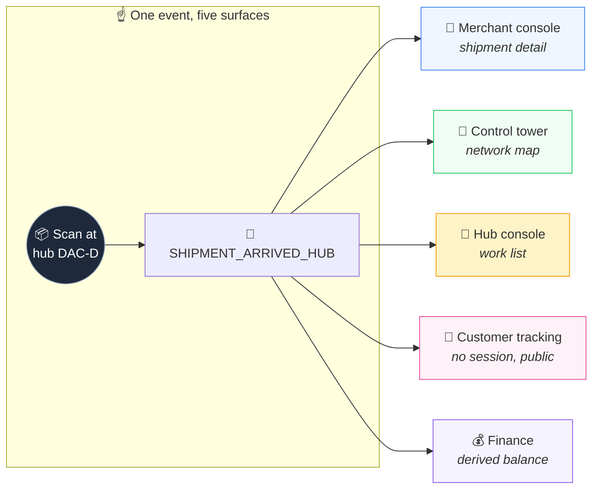

Five surfaces. One stream. No cross-schema `JOIN` anywhere — which is the only reason the diagram
above is true and not aspirational.

---

<a id="run"></a>

## 🚀 Run it

```bash
git clone https://github.com/mahabubone/zipzap && cd zipzap
pnpm install
cp .env.example .env

# Infrastructure, then the whole product in containers
docker compose -f infra/compose/docker-compose.yml up -d
pnpm db:migrate && pnpm db:seed      # prints three logins
pnpm dev                             # API :3000 · merchant :5173
```

Or one command, full stack, nothing else to configure:

```bash
cp .env.example .env && pnpm demo:up
```

The seed prints a merchant, a hub operator and an operations manager — three principals with
deliberately different scopes, because one account cannot demonstrate a system that separates
tenants.

| Surface             | URL                   | What it is                                                          |
| ------------------- | --------------------- | ------------------------------------------------------------------- |
| 🏪 Merchant console | `localhost:5173`      | Orders, parcels, COD reconciliation, settlements, webhooks          |
| 👤 Public tracking  | `localhost:5174`      | The same parcels, no account, no session                            |
| 📡 Control tower    | `localhost:5175`      | The network on a real basemap, for an operations manager            |
| 🏢 Hub console      | `localhost:5176`      | One hub, one work list, signed in as a person assigned to it        |
| 📚 Docs site        | `localhost:4321`      | Product docs and the API reference, generated from the OpenAPI spec |
| 🖥️ API · Swagger    | `localhost:3000/docs` | 93 operations, generated from the controller decorators             |

Only the tracking app pins its port; the rest take Vite's default cascade, so start them in that
order. [`docs/development/environment.md`](docs/development/environment.md) has the container path and
the troubleshooting notes.

---

<a id="flow"></a>

## 🧭 The end-to-end flow


Every arrow is a real state transition in [`state-machine.ts`](apps/backend/src/modules/shipment/rules/state-machine.ts),
validated rather than written: a status column is never `UPDATE`d directly, it changes only through a
transition that checks the current state.

---

<a id="architecture"></a>

## 🏛️ Architecture: one deployable, seventeen owners

A modular monolith. Microservices are an extraction strategy, never a starting point.

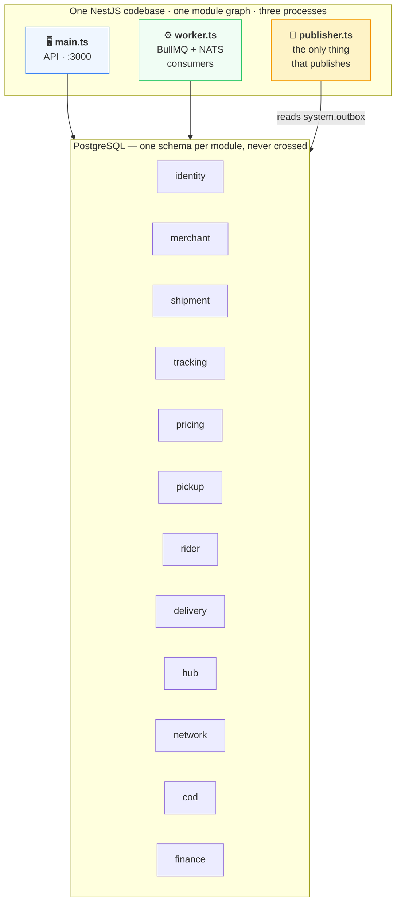

Seventeen modules, each owning its own Postgres schema, each unreachable from any other by SQL. The
rule is enforced by a checker that runs before every commit, not promised in a README.

---

<a id="events"></a>

## 🔁 How an event travels

The transactional outbox is the spine. Every mutation writes its outbox row **in the same
transaction** as the change it describes, so the event and the fact can never disagree.

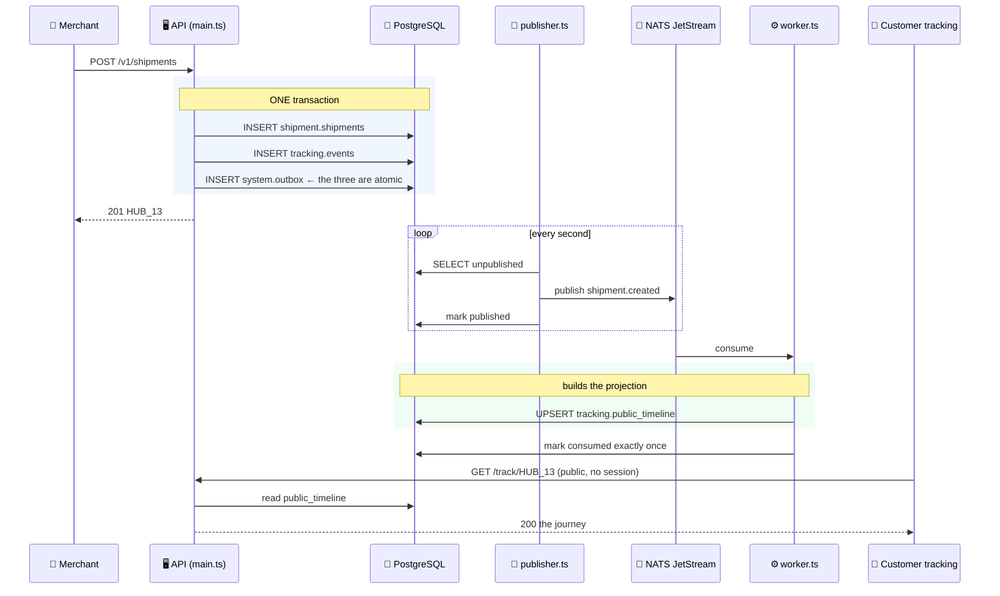

This is why the worker must be running: `tracking.public_timeline` is a **projection the worker
builds**, so `/track/:code` 404s for a fresh parcel if only the API is up. That is the architecture
showing through, not a defect.

---

<a id="money"></a>

## 📐 The money rules

Cash-on-delivery is where a logistics system either earns trust or loses it. Four rules, each
enforced in a place that cannot be forgotten.

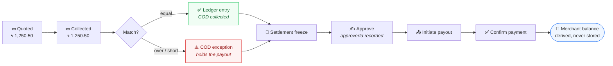

| Rule                    | Where it lives                                       | Why it cannot be skipped                                                                                                                        |
| ----------------------- | ---------------------------------------------------- | ----------------------------------------------------------------------------------------------------------------------------------------------- |
| **Integer minor units** | `common/money.ts` · `@MoneyMinor` DTOs · `MoneyText` | `boundaries:check` fails the commit on a float in a money field, and the browser formats the same integer the API stores — the two cannot drift |
| **Append-only ledger**  | DB triggers reject UPDATE/DELETE                     | A correction is a compensating row. There is no API to edit history, and no account with the scope to ask for one                               |
| **Derived balances**    | `finance` sums its own ledger                        | The balance column is not stored, so there is nothing to corrupt. The screen shows the lines that made it up                                    |
| **Settlement blocker**  | `COD_LOOKUP`, read before the freeze                 | Cash in transit cannot be frozen, so a settlement cannot be created against money that has not landed                                           |

`MoneyText` in `packages/ui` carries its own tests because it once divided a float and rounded
wrongly — the class of bug a screenshot hides and an assertion does not.

---

<a id="stack"></a>

## 🏗️ Technology Stack

**Architecture**: Event-driven architecture with CQRS logically separated, a transactional outbox, and
monorepo tooling (pnpm workspaces + Turbo). Microservices are an extraction strategy, not a starting
point.

**Authentication**: JWT for API clients · HttpOnly session cookies for browsers, behind a same-origin
proxy

**Authorization**: Role-based access control with scoped permissions, and hub assignment as a second
axis — a hub manager's power says _what_, their assignment says _where_

**Frontend**: React 19 · TanStack Router/Start (SSR) · Expo / React Native (rider) · Astro 7 (docs
site) · Tailwind CSS

**Backend**: NestJS 12 · TypeORM 1.1 · OpenAPI generated from controller decorators

**Database**: PostgreSQL 18 + PostGIS · Redis (cache, rate limits, idempotency) · NATS JetStream

**Event bus**: NATS JetStream — _what happened_
**Message queue**: BullMQ — _do the work_
**Cache**: Redis, never authoritative

**Observability**: OpenTelemetry · Prometheus · Grafana · pino, correlated by `request_id`

> [!NOTE]
> This repository is a demonstration of the architecture. It is not a production-ready system. The
> backend got far more attention than the frontends and mobile app in terms of UI design and UX —
> they are functional and in the design system, not finished products.

### Why each choice, not just what

A list of names says nothing a search engine cannot. The table below is the part that is hard to
find elsewhere, because most of these decisions are invisible until they go wrong.

| Layer             | Choice                                      | The reason, not the list                                                                                                                                                                        |
| ----------------- | ------------------------------------------- | ----------------------------------------------------------------------------------------------------------------------------------------------------------------------------------------------- |
| **Runtime**       | Node 24 · pnpm 11 · Turbo 2.11              | Strict ESM and a workspace graph, so a package cannot import another's internals by accident                                                                                                    |
| **Backend**       | NestJS 12                                   | Dependency injection with real module boundaries — `forModule('identity', […])` scopes a connection per module, which makes a cross-schema query _fail at runtime_ rather than degrade silently |
| **ORM**           | TypeORM 1.1                                 | `synchronize: false` permanently. Every schema change is a reviewed, reversible migration — the gate runs `db:migrate`, `db:revert`, `db:migrate` on every push                                 |
| **Database**      | PostgreSQL 18 + PostGIS                     | Coverage, service areas and routing are spatial. A healthcheck runs `SELECT postgis_version()`, because "accepts connections" is not "works"                                                    |
| **Async**         | NATS JetStream · BullMQ · Redis             | NATS says _what happened_; BullMQ _does the work_; Redis holds rate limits and idempotency and is **never** authoritative                                                                       |
| **Language**      | TypeScript 6.0                              | Pinned deliberately. TypeScript 7 ships `tsc` only with no programmatic API, which breaks `@nestjs/cli` builds                                                                                  |
| **Web**           | React 19 · TanStack Router/Start            | One codebase, SSR. The auth guard runs in `beforeLoad` _on the server_, so an unauthenticated visitor gets a 307 rather than a flash of console                                                 |
| **Design system** | `packages/ui`                               | 71 components across atoms, molecules and organisms · 338 tests · Storybook. A screen that is not in the kit does not get built                                                                 |
| **Mobile**        | Expo / React Native                         | Offline-first queue with per-command idempotency                                                                                                                                                |
| **Docs**          | Astro 7                                     | The API reference is generated from the same spec the typed client is generated from, so it cannot drift                                                                                        |
| **Observability** | OpenTelemetry · Prometheus · Grafana · pino | The publisher and worker expose metrics; the correlation is `request_id`                                                                                                                        |

Full reasoning, with the alternatives that were rejected, lives in
[`docs/architecture/overview.md`](docs/architecture/overview.md) and
[17 ADRs](docs/ADR/).

---

<a id="proof"></a>

## 🧪 What proves it works

```bash
pnpm verify               # boundaries → format → typecheck → 2,433 unit tests
pnpm test:integration     # 80 tests on real Postgres, Redis and NATS
pnpm boundaries:check     # the architecture gate
```

|                                               |                                             |
| --------------------------------------------- | ------------------------------------------- |
| Domain modules, each owning a Postgres schema | **17**                                      |
| HTTP operations in the generated OpenAPI spec | **93** across 83 paths                      |
| Unit tests                                    | **2,433**                                   |
| Integration tests on live infrastructure      | **80** across 16 files                      |
| Reviewed, reversible migrations               | **51**                                      |
| Architecture decision records                 | **17**, each with the alternatives rejected |
| Documentation files                           | **77** markdown                             |
| Screenshots, all regenerable by `pnpm shots`  | **42** across 6 apps                        |
| Code                                          | ~84k lines of TypeScript, TSX and Astro     |

### The gates, and what they actually prevent


`boundaries:check` is 194 lines of zero-dependency JavaScript and the highest-leverage file in the
repository: it fails the gate on the failure modes this architecture is most at risk of, all of which
are invisible to a human reading a small diff.

---

<a id="surfaces"></a>

## 🖼️ Surfaces

### The merchant console

<table>
<tr>
<td colspan="2" align="center"></td>
</tr>
<tr>
<td colspan="2" align="center"><sub>Twelve events, every one attributed — merchant, operations or rider. The history is append-only: a correction is a new row, never an edit.</sub></td>
</tr>
</table>

<table>
<tr>
<td width="50%">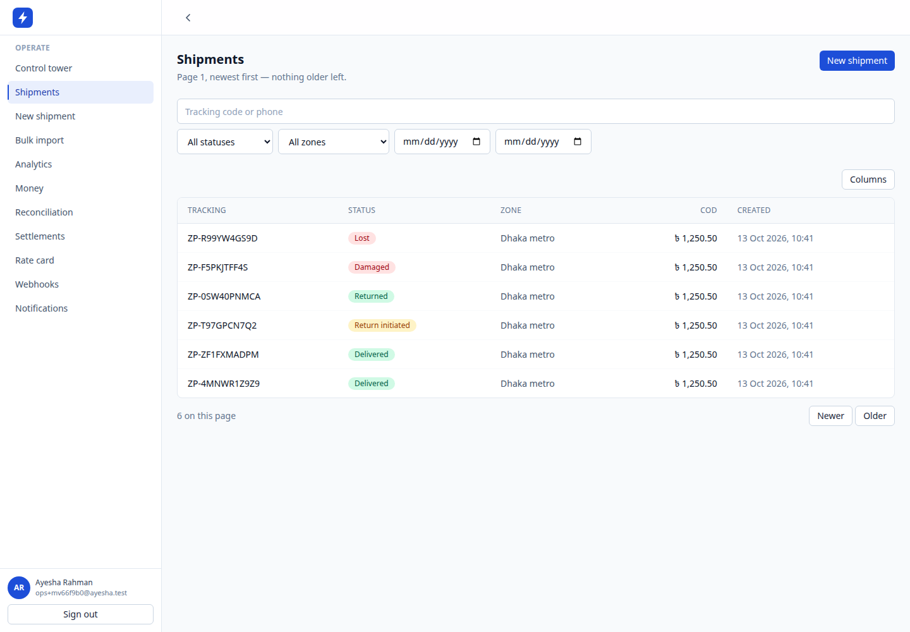</td>
<td width="50%">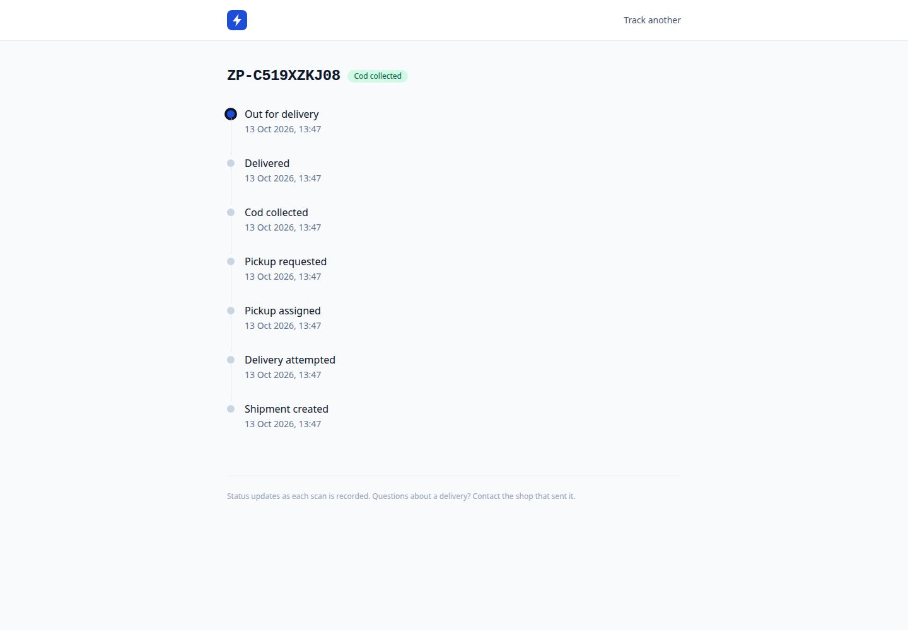</td>
</tr>
<tr>
<td colspan="2" align="center"><sub>Left: the merchant. Right: the customer — same parcel, no session, a different app on a different origin, one event stream underneath.</sub></td>
</tr>
</table>

<table>
<tr>
<td width="50%">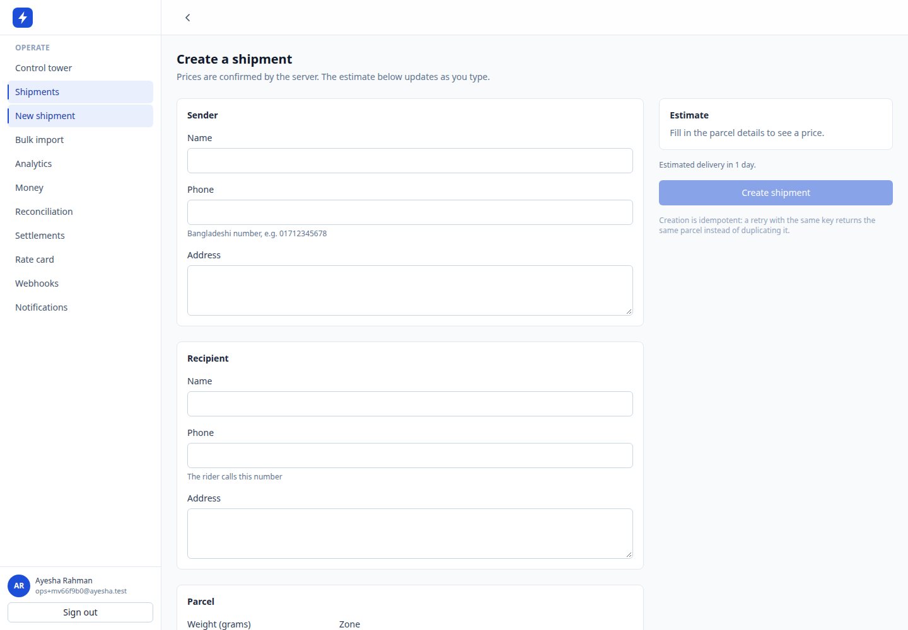</td>
<td width="50%">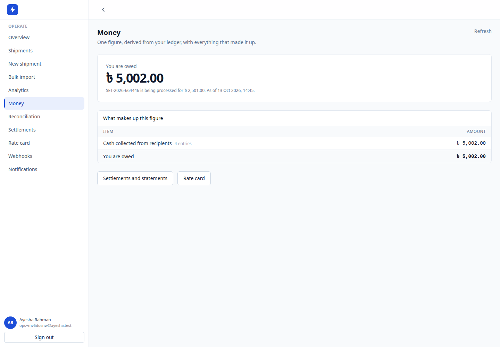</td>
</tr>
<tr>
<td colspan="2" align="center"><sub>Live server pricing with a coverage check before the write · a balance <b>derived</b> from an append-only ledger, never a stored column, with the lines that made it up shown on screen.</sub></td>
</tr>
</table>

### Operations

<table>
<tr>
<td colspan="2" align="center"></td>
</tr>
<tr>
<td colspan="2" align="center"><sub>Leaflet on OpenStreetMap. Markers are drawn by the app from coordinates the API returned; the basemap is decoration, and when it stops answering the screen swaps itself to a list rather than leaving an operator with a grey rectangle. A rider who stops checking in goes <b>grey</b>, not red, because an ops console that paints everything red stops being read — and the footer counts what it could not place instead of dropping it silently.</sub></td>
</tr>
</table>

### The hub

A hub console used to open on a list of six hubs. It no longer does: a person is _assigned_ to a hub,
`GET /v1/hubs/my-hub` says which, and the app lands there. Someone between hubs gets a screen that
says so, because "you are not assigned" is a state a manager can fix in thirty seconds and a login
loop cannot be fixed at all.

<table>
<tr>
<td width="50%">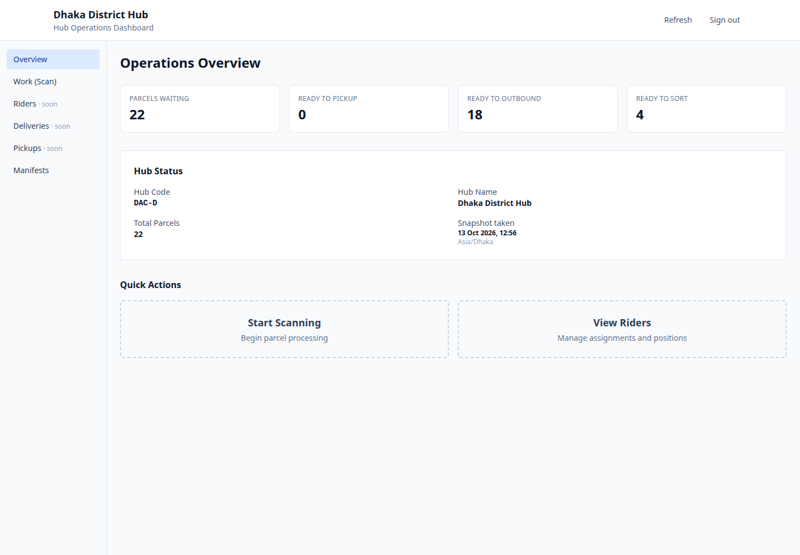</td>
<td width="50%"></td>
</tr>
<tr>
<td align="center"><sub>Overview: what is waiting, and in what state.</sub></td>
<td align="center"><sub>Work: one row per parcel, one button per row — and the button is the server's own answer.</sub></td>
</tr>
</table>

There is no dropdown of scan types here, on purpose. A picker invites choosing `OUTBOUND` on a parcel
that has not been sorted, and the machine then refuses with a 409 the operator has to read. Offering
only the gesture the server would accept makes an out-of-order scan inexpressible through this
screen. An out-of-order scan is still reachable — by scanning the wrong _parcel_ — and that refusal
is rendered in full, above the list, in the machine's own words.

<table>
<tr>
<td colspan="2" align="center">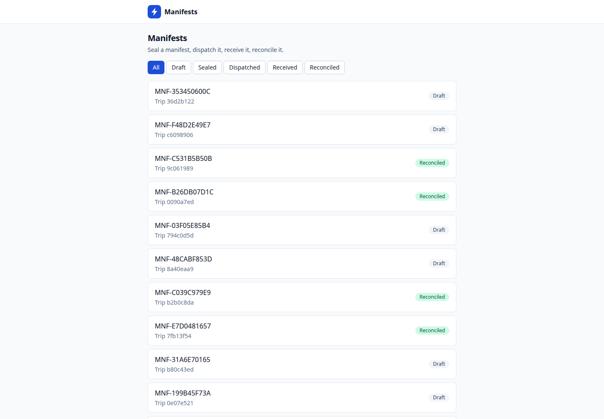</td>
</tr>
<tr>
<td colspan="2" align="center"><sub>Signed in as an operator whose only write scope is <code>hub:scan</code> — they can move parcels between hubs and cannot create, cancel or settle anything. Manifests are the other half of a shift: seal, dispatch, receive, reconcile.</sub></td>
</tr>
</table>

### Rider

<table>
<tr>
<td width="50%">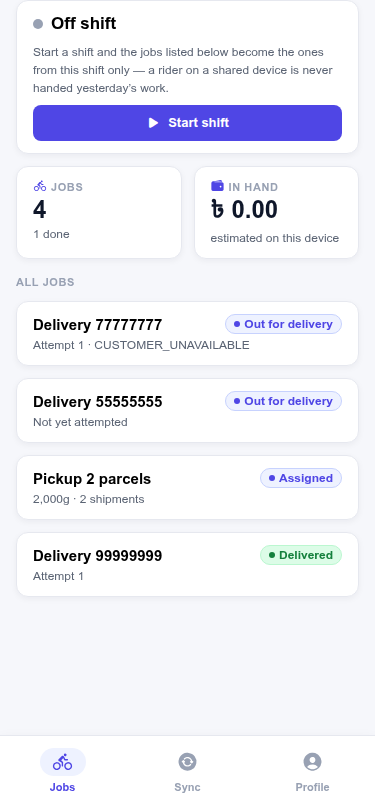</td>
<td width="50%">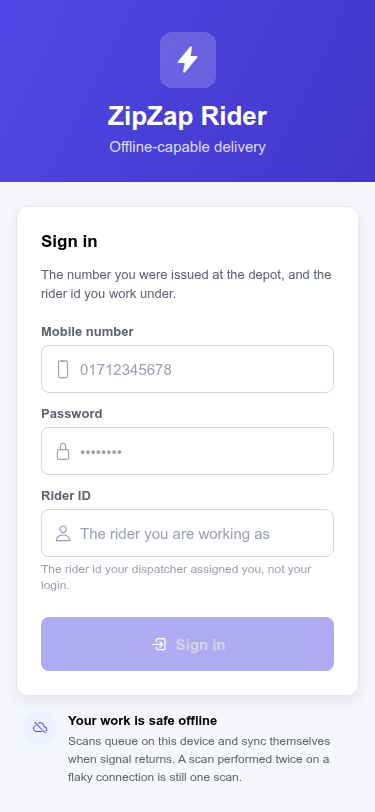</td>
</tr>
<tr>
<td colspan="2" align="center"><sub>Left: the shift feed, cash in hand. Right: the sign-in a rider actually meets — a mobile number, not an email. A rider in Dhaka is issued a SIM card at the depot, not a mailbox, and two people typing the same credentials is indistinguishable from one person on two devices. Every write appends to a durable offline queue; on reconnect it replays in order and the server's ruling is shown next to the believed state, including when it disagrees.</sub></td>
</tr>
</table>

<table>
<tr>
<td width="50%"></td>
<td width="50%">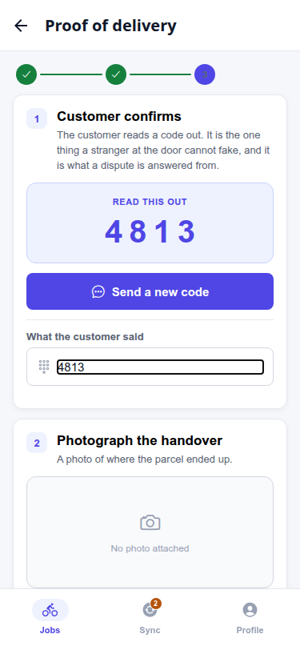</td>
</tr>
<tr>
<td align="center"><sub>A delivery: who to call, and the cash to collect in <b>whole poisha</b> — a decimal is refused rather than rounded, because a rider hands over cash, not a float.</sub></td>
<td align="center"><sub>Proof: the OTP, the photo, the location — or nothing is delivered.</sub></td>
</tr>
</table>

### Docs

<table>
<tr>
<td colspan="2" align="center">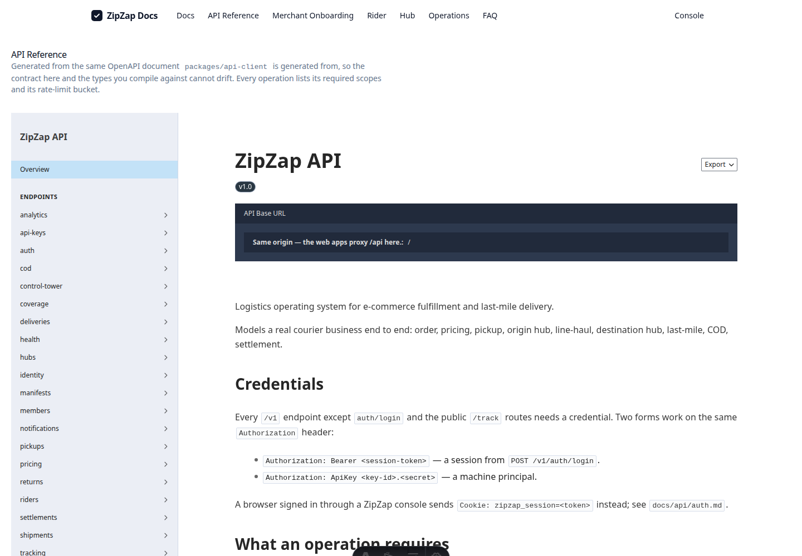</td>
</tr>
<tr>
<td colspan="2" align="center"><sub>Generated from the same spec the typed client is generated from — so its presence is evidence the contract is current, not a hand-written page that drifted months ago.</sub></td>
</tr>
</table>

---

<a id="docs"></a>

## 📚 Documentation

|                       |                                                                                              |
| --------------------- | -------------------------------------------------------------------------------------------- |
| 🎯 Product            | [`docs/product/`](docs/product/) — vision, personas, competition, roadmap                    |
| 🏛️ Architecture       | [`docs/architecture/overview.md`](docs/architecture/overview.md) — modules, boundaries, flow |
| 🧩 Domains            | [`docs/domains/`](docs/domains/) — one file per business domain                              |
| 📜 ADRs               | [`docs/ADR/`](docs/ADR/) — 17 decisions, each with the alternatives rejected                 |
| 🔌 API                | [`docs/api/`](docs/api/) — auth, versioning, errors, webhooks, pagination                    |
| 🧪 Testing            | [`docs/testing/`](docs/testing/) — strategy, fixtures, conventions                           |
| 🚀 Operations         | [`docs/operations/`](docs/operations/) — deployment, observability, runbooks                 |
| 🤝 Working agreements | [`AGENTS.md`](AGENTS.md) — the rules this codebase is written against                        |

### The ADRs worth reading first

| #                                                     | Decision                                                  |
| ----------------------------------------------------- | --------------------------------------------------------- |
| [0001](docs/ADR/0001-modular-monolith.md)             | Modular monolith over microservices                       |
| [0002](docs/ADR/0002-postgresql-schema-boundaries.md) | One schema per module, no cross-schema access             |
| [0005](docs/ADR/0005-transactional-outbox.md)         | Transactional outbox for event publication                |
| [0009](docs/ADR/0009-money-representation.md)         | Integer minor units + currency                            |
| [0010](docs/ADR/0010-idempotency.md)                  | Mandatory `Idempotency-Key` on money and physical actions |
| [0012](docs/ADR/0012-rider-offline-sync.md)           | Offline queue with per-command idempotency                |
| [0016](docs/ADR/0016-http-only-sessions.md)           | HttpOnly sessions behind a same-origin proxy              |
| [0017](docs/ADR/0017-integration-test-harness.md)     | Integration tests wire their graph through one harness    |

---

<a id="not-built"></a>

## ⚠️ What is not built

Stated plainly, because a portfolio that only lists its strengths is telling you something.

- **Support, admin and developer-portal consoles** are planned and absent — no packages exist.
- **The rider's native bundle does not build.** `expo export --platform ios` fails inside
  `react-native-screens`; the web export used for these screenshots is the only bundle.
- **The Electron kiosk shell typechecks but does not build.** `apps/desktop`'s `build` script calls a
  `vite` it does not depend on, so `pnpm build` fails on that one workspace.
- **Three of the six hub-console sidebar destinations are placeholders** — riders, deliveries and
  pickups render a designed empty state, not data.
- **No deployment beyond `docker compose`.** No Kubernetes, no Terraform, no blue-green.
- **Roadmap boxes are still open**, concentrated in surfaces, security hardening, observability
  dashboards and load testing.

---

## 🙏 Credits & Contact

**Built and designed by [Mahabub](https://github.com/mahabubone).**

📧 **Email** · `iam.mahabub@proton.me`
💼 **LinkedIn** · `linkedin.com/in/mahabubone`

### Libraries this is built on

[NestJS](https://nestjs.com) · [TypeORM](https://typeorm.io) · [PostgreSQL](https://www.postgresql.org) ·
[PostGIS](https://postgis.net) · [NATS JetStream](https://nats.io) · [BullMQ](https://docs.bullmq.io) · [Redis](https://redis.io) ·
[React](https://react.dev) · [TanStack](https://tanstack.com) · [Expo](https://expo.dev) ·
[Astro](https://astro.build) · [Leaflet](https://leafletjs.com) · [OpenStreetMap](https://www.openstreetmap.org) ·
[Vitest](https://vitest.dev) · [OpenTelemetry](https://opentelemetry.io)

---

<a id="every-screen"></a>

## 📸 Every screen, shot by shot

Forty-two screenshots across six applications — merchant console, public tracking, control tower, hub
console, rider app and docs site. **Every one is regenerable** — this is not a curated gallery:
`pnpm shots` rebuilds the whole directory against a running stack, so the images cannot drift from
what the code renders.

```bash
pnpm infra:up && pnpm db:migrate
eval "$(pnpm db:seed | sed -n '/^export /p')"   # the scripts log in as these principals
pnpm seed:shots                                 # a fixture worth photographing
pnpm shots                                      # web · tracking · hub · ops · site · mobile
```

Each app's script logs in through its own real form with a seeded principal, visits its own routes,
and refuses to photograph an error box or an empty state that is standing in for a feature. A few
also appear above, next to the commentary they belong to. Where they repeat it is on purpose: the
section above argues, this one indexes.

> **Run `seed:shots` after the integration suite, never before.**
> `dashboard.integration.test.ts` starts by emptying `shipment.shipments`, `rider.riders`,
> `cod.records` and the delivery tables — it is testing projections and wants a known-empty world.
> That is the right behaviour for a test and a nasty surprise for a demo database: seeded fixture
> data disappears, and the next run photographs an empty state that looks nothing like a broken
> product but is exactly as convincing as one.

### 🏪 Merchant console — 18 shots

<table>
<tr>
<td width="50%">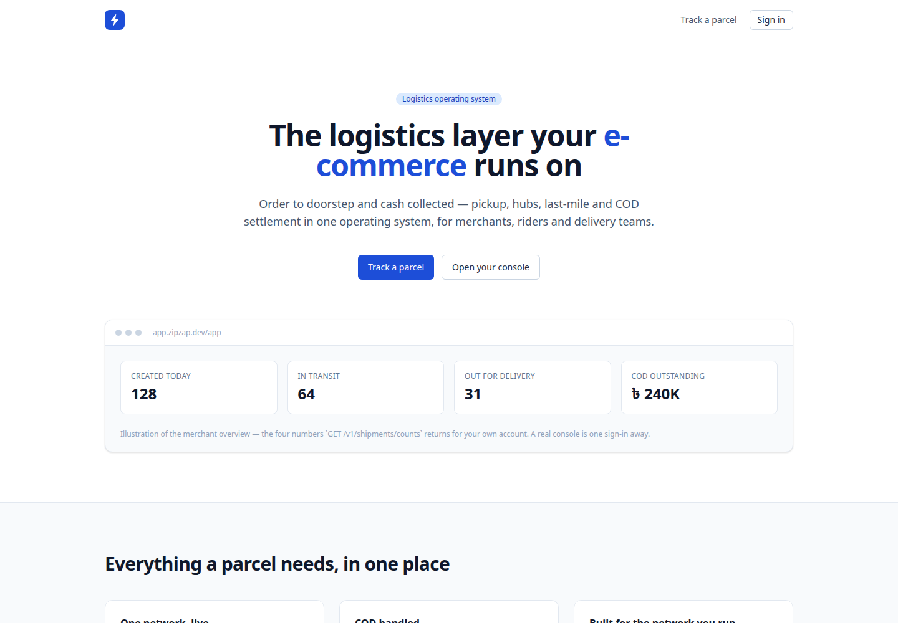</td>
<td width="50%">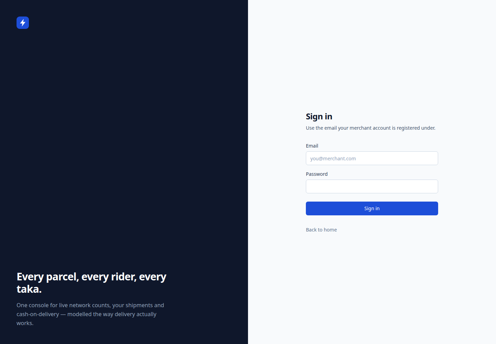</td>
</tr>
<tr>
<td align="center"><sub>Landing — the pitch, before any session</sub></td>
<td align="center"><sub>Sign in — cookie session, no token in storage</sub></td>
</tr>
<tr>
<td width="50%"></td>
<td width="50%">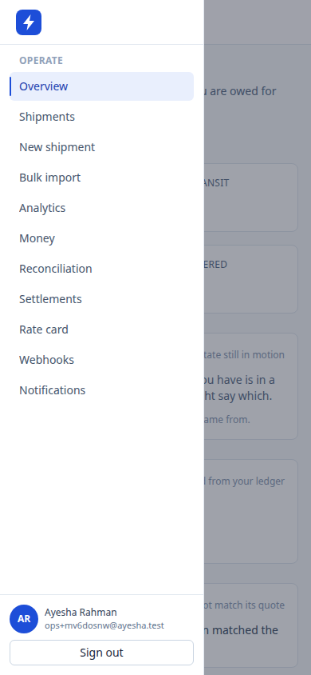</td>
</tr>
<tr>
<td align="center"><sub>The login split at 900px, where the panel hides</sub></td>
<td align="center"><sub>The console at 390px, drawer open</sub></td>
</tr>
<tr>
<td width="50%"></td>
<td width="50%"></td>
</tr>
<tr>
<td align="center"><sub>Six lifecycle states on one page — and a filter that narrows it to one</sub></td>
<td align="center"><sub>Twelve-step history, every actor attributed</sub></td>
</tr>
<tr>
<td width="50%">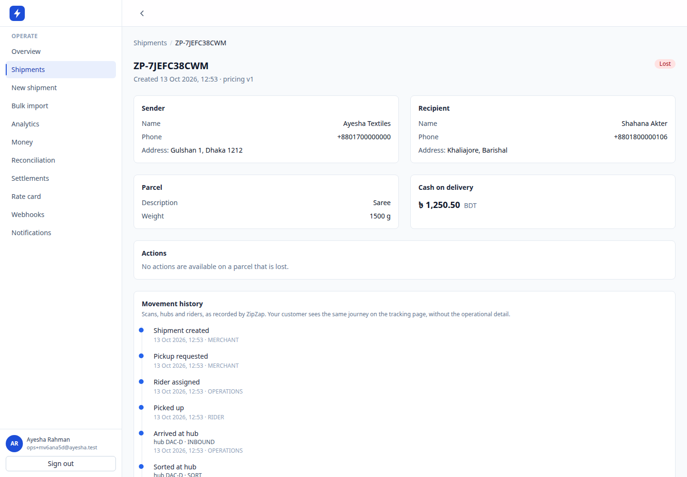</td>
<td width="50%"></td>
</tr>
<tr>
<td align="center"><sub>A lost parcel — actions off, history intact</sub></td>
<td align="center"><sub>Live server pricing and a coverage check</sub></td>
</tr>
<tr>
<td width="50%">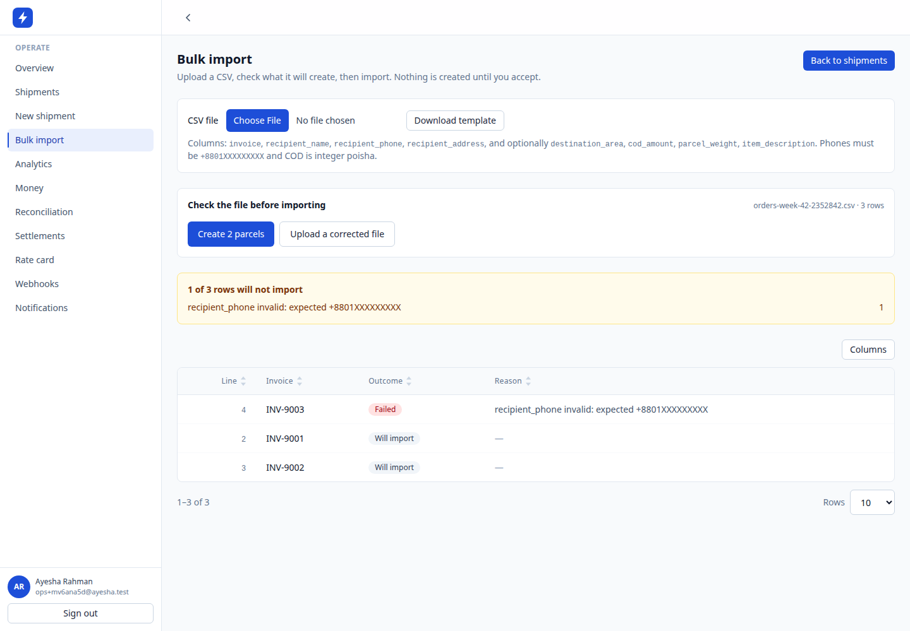</td>
<td width="50%"></td>
</tr>
<tr>
<td align="center"><sub>Bulk import: three rows in, and the screen says which two will create a parcel — the failed row first, with the server's reason. Nothing is written until <b>Create 2 parcels</b> is pressed.</sub></td>
<td align="center"><sub>A balance derived from the ledger, not stored</sub></td>
</tr>
<tr>
<td width="50%">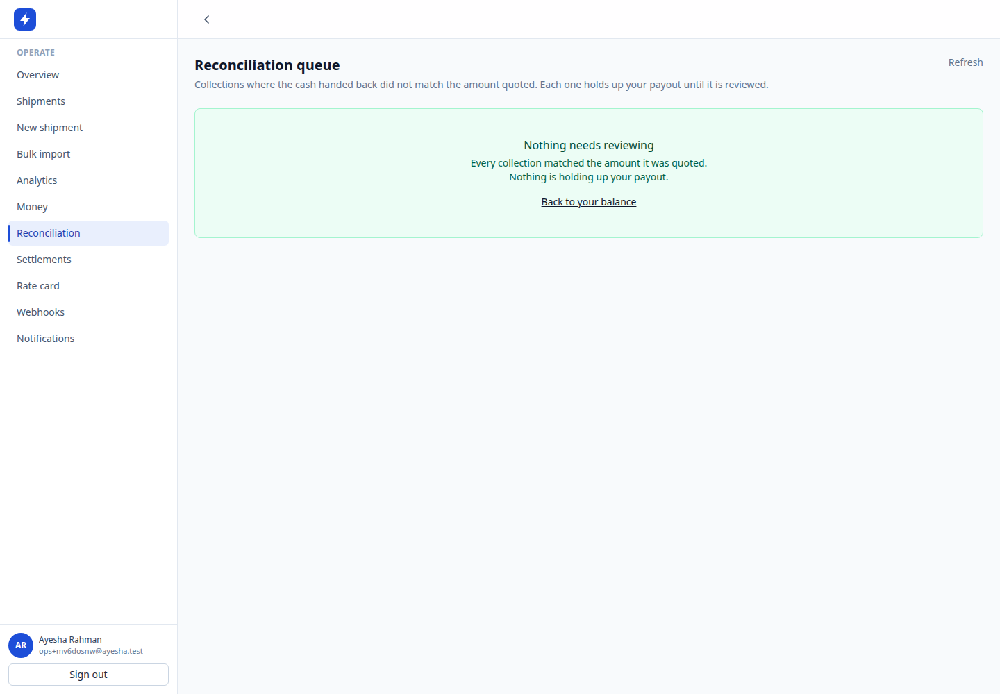</td>
<td width="50%">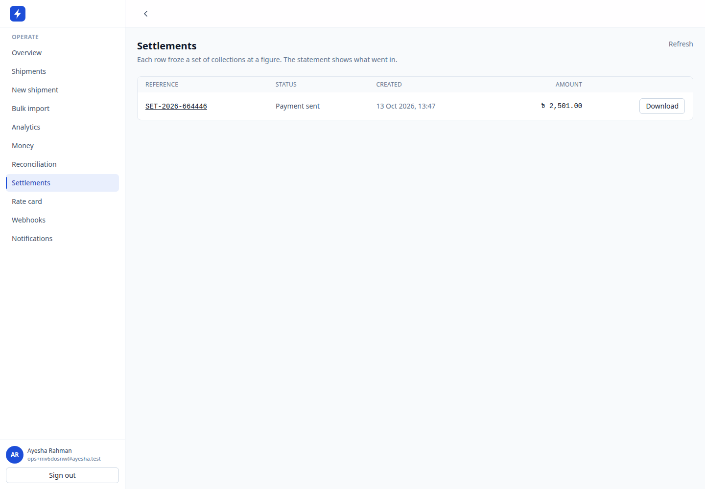</td>
</tr>
<tr>
<td align="center"><sub>The reconciliation queue — empty because every collection matched what it was quoted, and it says exactly that instead of showing a spinner forever</sub></td>
<td align="center"><sub>Settlements, with a downloadable statement</sub></td>
</tr>
<tr>
<td width="50%">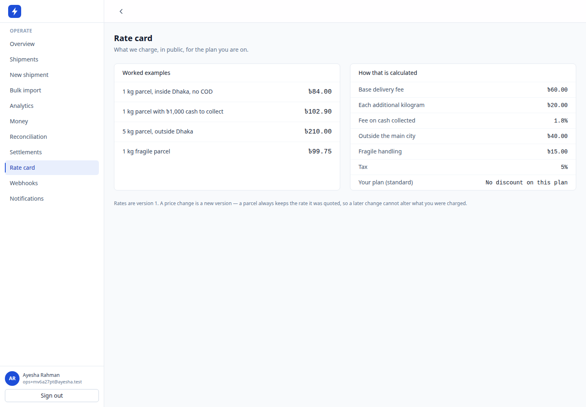</td>
<td width="50%">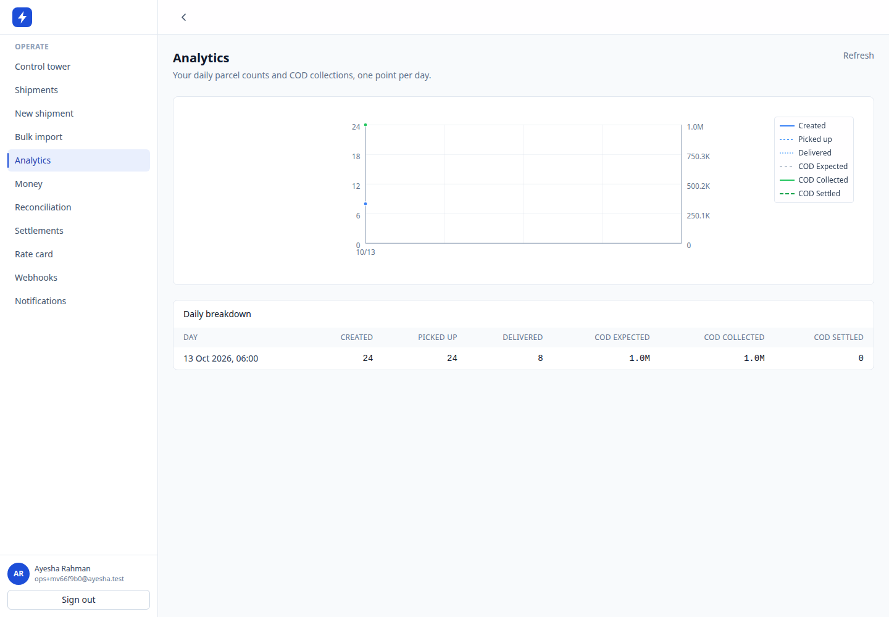</td>
</tr>
<tr>
<td align="center"><sub>Rate card, with worked examples</sub></td>
<td align="center"><sub>Analytics over the same event stream</sub></td>
</tr>
<tr>
<td width="50%">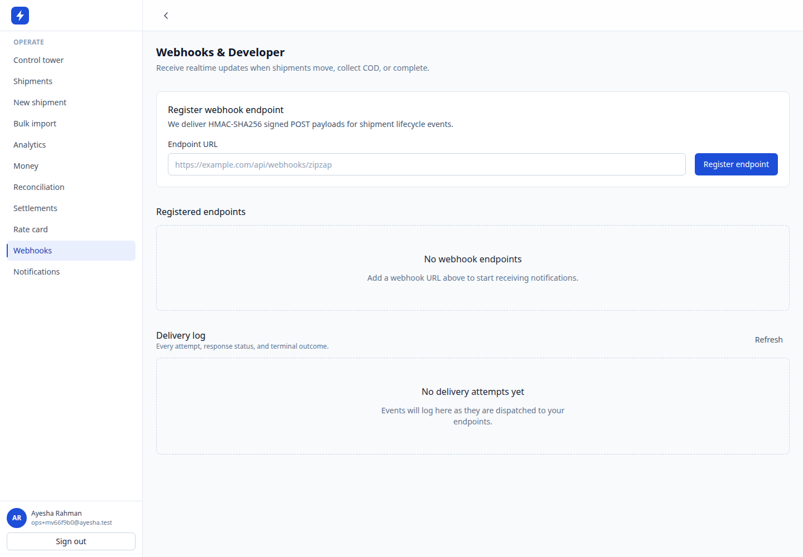</td>
<td width="50%">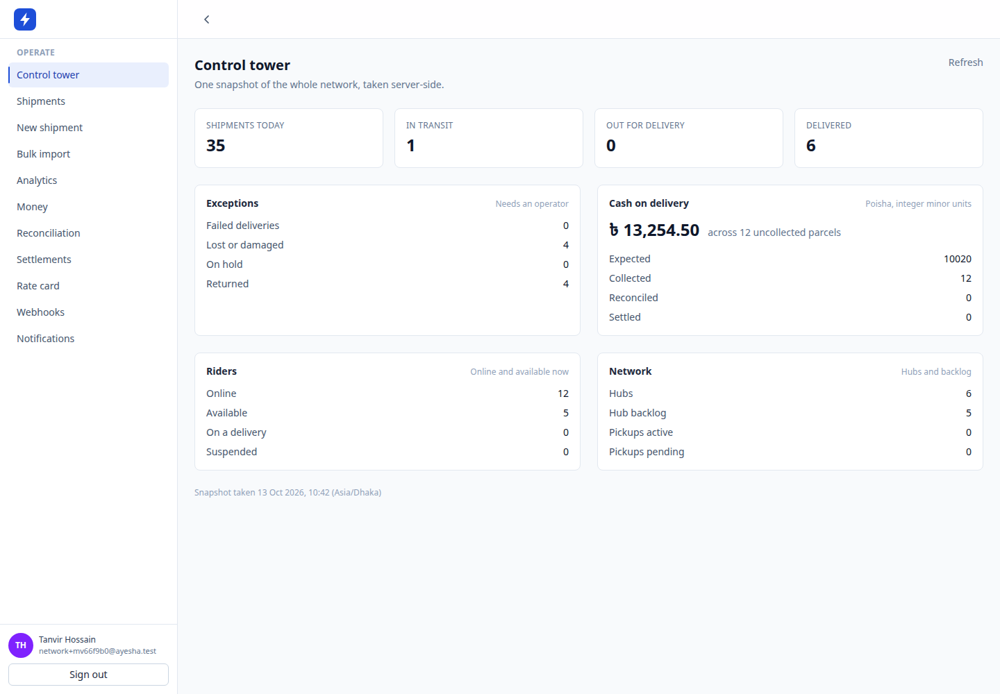</td>
</tr>
<tr>
<td align="center"><sub>Webhooks with a per-attempt delivery log</sub></td>
<td align="center"><sub>Control tower, as an operations manager</sub></td>
</tr>
<tr>
<td width="50%">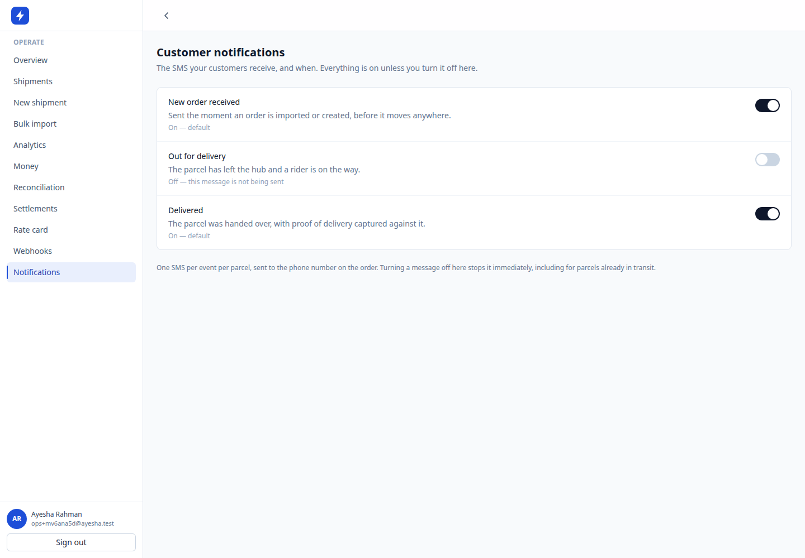</td>
<td width="50%">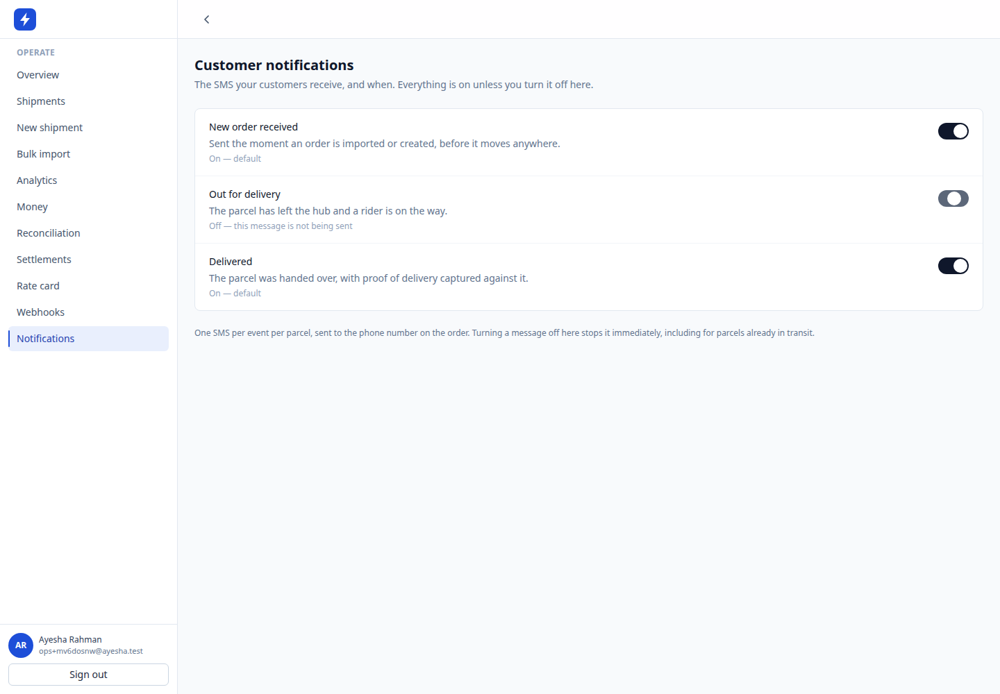</td>
</tr>
<tr>
<td align="center"><sub>Notification preferences, as shipped</sub></td>
<td align="center"><sub>The same, toggled to a real merchant state</sub></td>
</tr>
</table>

### 👤 Customer tracking — 3 shots

<table>
<tr>
<td width="50%"></td>
<td width="50%"></td>
</tr>
<tr>
<td align="center"><sub>Enter a code — no account, no session</sub></td>
<td align="center"><sub>The journey, without the operational detail</sub></td>
</tr>
<tr>
<td width="50%"></td>
<td></td>
</tr>
<tr>
<td align="center"><sub>An unknown code, answered plainly — this is a separate app on a separate origin, sharing nothing but the event stream</sub></td>
<td></td>
</tr>
</table>

### 📡 Operations — 3 shots

<table>
<tr>
<td width="33%"></td>
<td width="33%">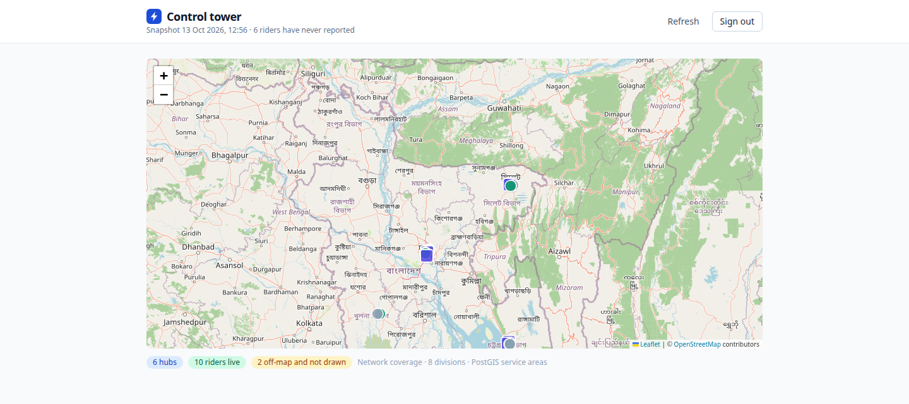</td>
<td width="33%">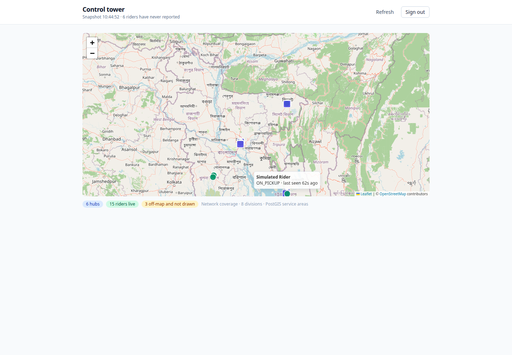</td>
</tr>
<tr>
<td align="center"><sub>Whole network, fitted</sub></td>
<td align="center"><sub>Zoomed to where the density is</sub></td>
<td align="center"><sub>One marker hovered — the reason the screen exists</sub></td>
</tr>
</table>

### 🏢 Hub console — 3 shots

<table>
<tr>
<td width="50%"></td>
<td width="50%"></td>
</tr>
<tr>
<td align="center"><sub>Overview — the landing screen, reached through <code>/my-hub</code></sub></td>
<td align="center"><sub>The work list — the screen the console is for</sub></td>
</tr>
<tr>
<td width="50%"></td>
<td></td>
</tr>
<tr>
<td align="center"><sub>Route manifests and reconciliation</sub></td>
<td></td>
</tr>
</table>

### 🚴 Rider — 11 shots

<table>
<tr>
<td width="50%"></td>
<td width="50%"></td>
</tr>
<tr>
<td align="center"><sub>Mobile number, numeric keypad</sub></td>
<td align="center"><sub>Shift feed with cash in hand</sub></td>
</tr>
<tr>
<td width="50%">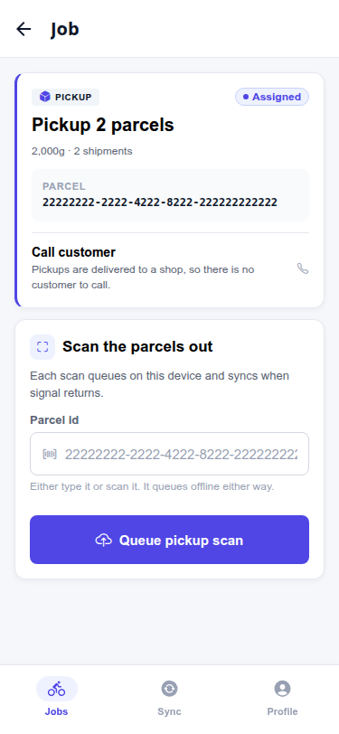</td>
<td width="50%">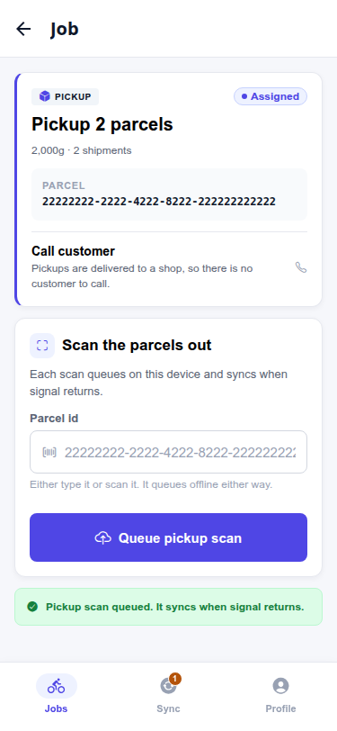</td>
</tr>
<tr>
<td align="center"><sub>A pickup batch</sub></td>
<td align="center"><sub>Queued offline, confirmed with a sequence</sub></td>
</tr>
<tr>
<td width="50%"></td>
<td width="50%">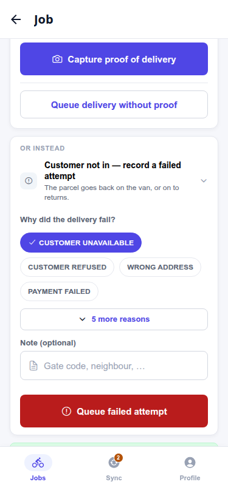</td>
</tr>
<tr>
<td align="center"><sub>A delivery, with what to collect</sub></td>
<td align="center"><sub>A failed attempt, queued</sub></td>
</tr>
<tr>
<td width="50%"></td>
<td width="50%"></td>
</tr>
<tr>
<td align="center"><sub>Proof capture, empty</sub></td>
<td align="center"><sub>Proof captured — the OTP, the photo, the location</sub></td>
</tr>
<tr>
<td width="50%"></td>
<td width="50%">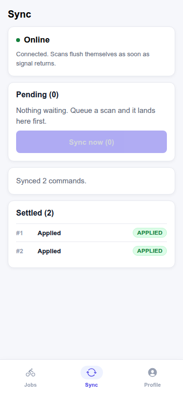</td>
</tr>
<tr>
<td align="center"><sub>The queue, believed-state visible</sub></td>
<td align="center"><sub>Settled rulings, including ones that disagreed</sub></td>
</tr>
<tr>
<td width="50%"></td>
<td></td>
</tr>
<tr>
<td align="center"><sub>Session and queue summary</sub></td>
<td></td>
</tr>
</table>

### 📚 Documentation site — 4 shots

<table>
<tr>
<td width="50%">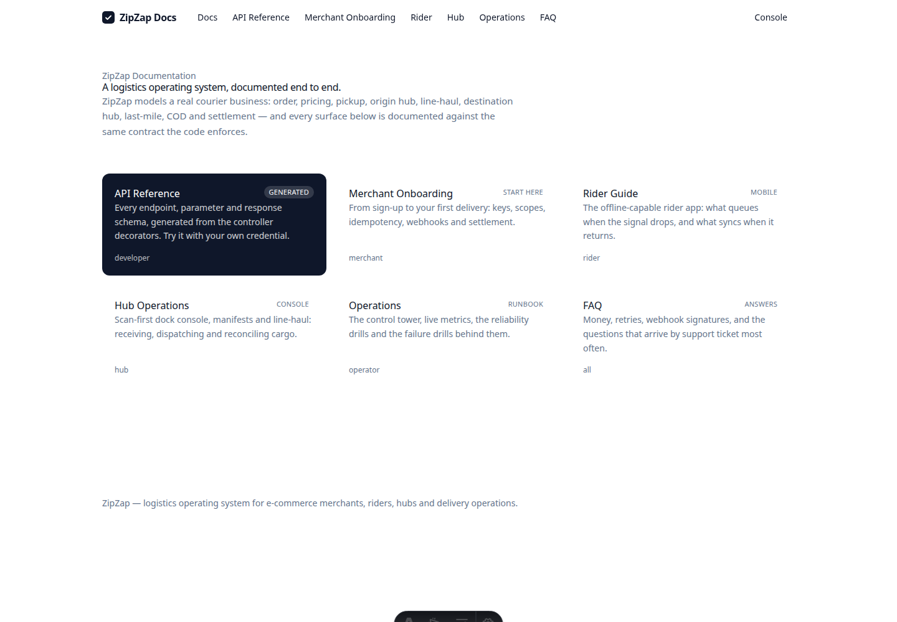</td>
<td width="50%"></td>
</tr>
<tr>
<td align="center"><sub>Catalog index across the guides</sub></td>
<td align="center"><sub>The API reference, generated from the same spec as the client</sub></td>
</tr>
<tr>
<td width="50%">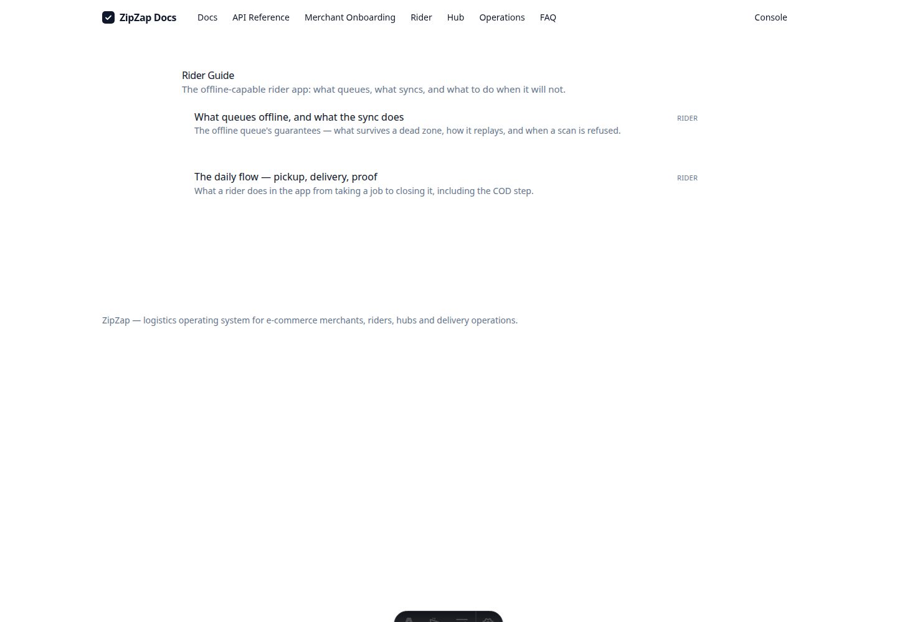</td>
<td width="50%">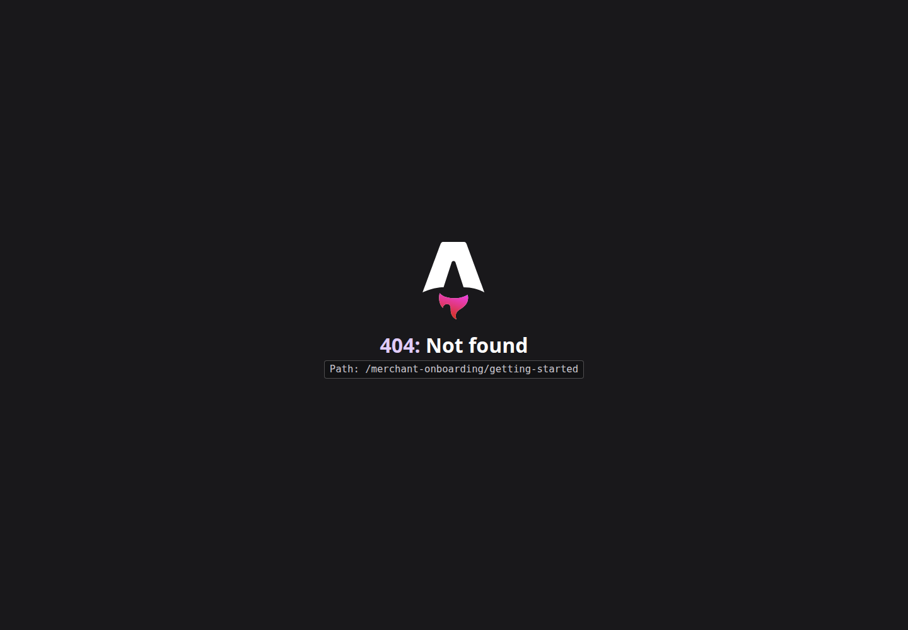</td>
</tr>
<tr>
<td align="center"><sub>The rider guide</sub></td>
<td align="center"><sub>Getting started, with idempotency explained</sub></td>
</tr>
</table>

---

## 📄 Licence

[CC BY-NC-ND 4.0](LICENSE) — read it, run it, learn from it, cite it with attribution.

**You may not use it commercially, and you may not redistribute a modified version.** That second
part is deliberate: this repository exists to demonstrate how I build systems, and the
demonstration is the authorship. If you want to build from these ideas, the architecture and its
reasoning are documented in [`docs/`](docs/) — build your own, tell me about it, and I will be
genuinely pleased.

Looking for a licence that allows modifications while still barring commercial use?
**CC BY-NC 4.0** is the one to ask for.

<div align="center">

<br/>

**⚡ ZipZap** · _The logistics layer your e-commerce runs on._

<sub>Cash-on-delivery first · integer minor units, always</sub>

</div>
