# ZipZap

**A logistics operating system for e-commerce fulfillment and last-mile delivery.**

Not a parcel tracker. ZipZap is the internal operating platform of a courier business —
merchant onboarding through COD reconciliation to settlement — in one deployable modular
monolith. Built for Bangladesh first, where cash-on-delivery is the norm and the courier is the
whole business. The courier vertical is the first case, not the only one.

```text
Merchant ─► Shipment ─► Pickup ─► Origin hub ─► Line-haul ─► Destination hub
                                                                    │
      Settlement ◄── COD ◄── Delivered ◄── Last mile ◄── Out for delivery
```

<p align="center">
  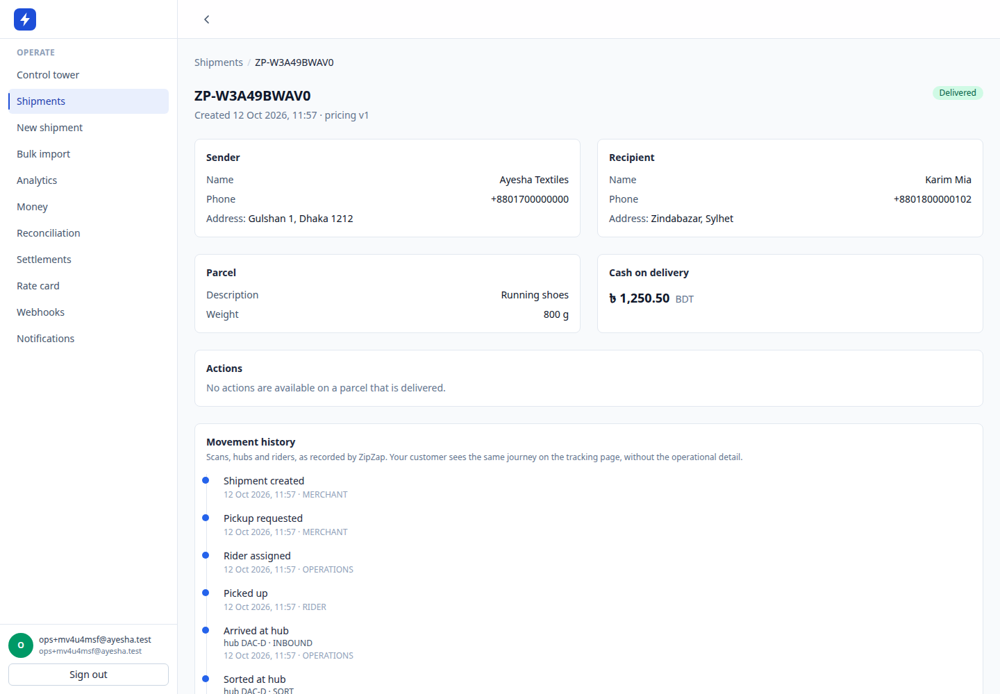
</p>

<p align="center">
  <em>One parcel, twelve events, every one attributed — merchant, operations or rider. The history
  is append-only: a correction is a new row, never an edit.</em>
</p>

---

## The thing worth looking at

**Simultaneity.** A parcel scanned at a hub has to appear at that instant in five places — the
merchant's shipment detail, the operations control tower, the rider's next job, the customer's
public tracking page, and the financial dashboard.

<p align="center">
  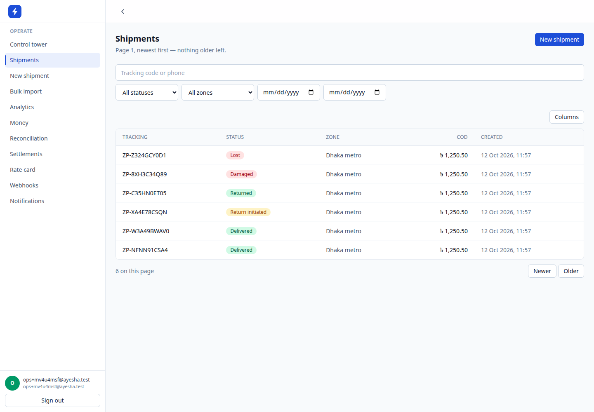
  
</p>

<p align="center">
  <em>Left: the merchant console. Right: the customer's public tracking page — same parcel, no
  session, a different app on a different origin, one event stream underneath.</em>
</p>

That is the acceptance test for the architecture, not a feature list. It only works if the module
boundaries held: five surfaces reading one event stream, none of them reading another's tables. A
CRUD app cannot demonstrate it, and neither can a system only one surface can see.

**One deployable, three entrypoints.**

```bash
node apps/backend/dist/main.js       # API        :3000
node apps/backend/dist/worker.js     # worker     BullMQ + NATS consumers
node apps/backend/dist/publisher.js  # publisher  the only thing that publishes to NATS
```

The worker is not optional. `tracking.public_timeline` is a projection the worker builds, so
`/track/:code` 404s for a fresh parcel if you start only the API. That is the architecture showing
through, not a defect — and it is why the tracking screenshot above is a real page rather than a
mock.

**Money is integer minor units.** `125050` poisha, never `1250.50`, never a float, anywhere —
including the formatting on screen. A UI division bug was caught and fixed here by a test that
compares against the backend's own formatter, because a screen and an invoice that disagree by one
poisha is a support call.

---

## Surfaces

Five applications, one contract. Every screenshot below is a real route against a real database —
the `shots/` directory is regenerated by `pnpm shots`, not hand-curated.

### Merchant console

<p align="center">
  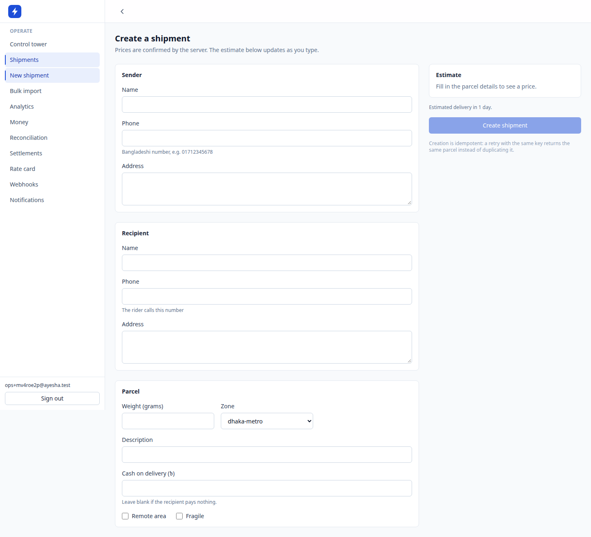
</p>

<p align="center">
  <em>Live server pricing, a coverage check before the write, and an Idempotency-Key so a retry
  returns the same parcel instead of creating a second one.</em>
</p>

<p align="center">
  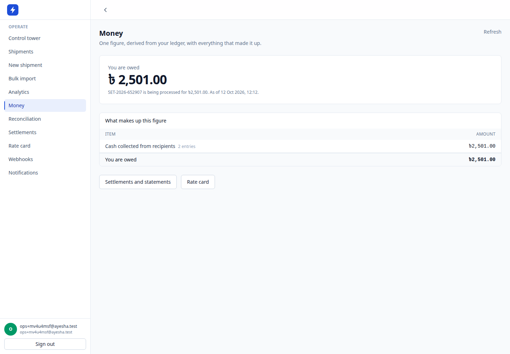
  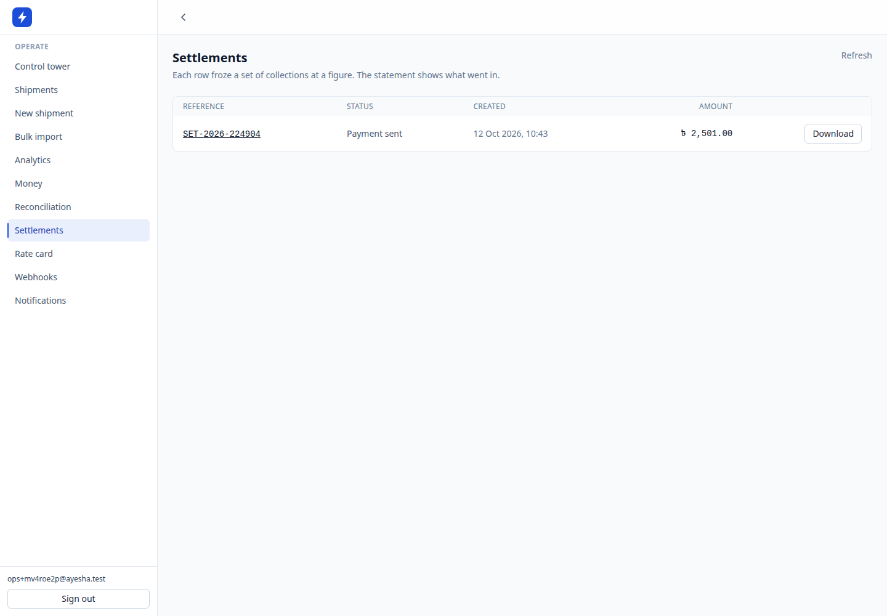
</p>

<p align="center">
  <em>The merchant balance is <em>derived</em> from an append-only ledger, never a stored column —
  and the screen shows the lines that made it up. Cash on delivery and settlement are the reason
  this vertical exists in Bangladesh.</em>
</p>

<p align="center">
  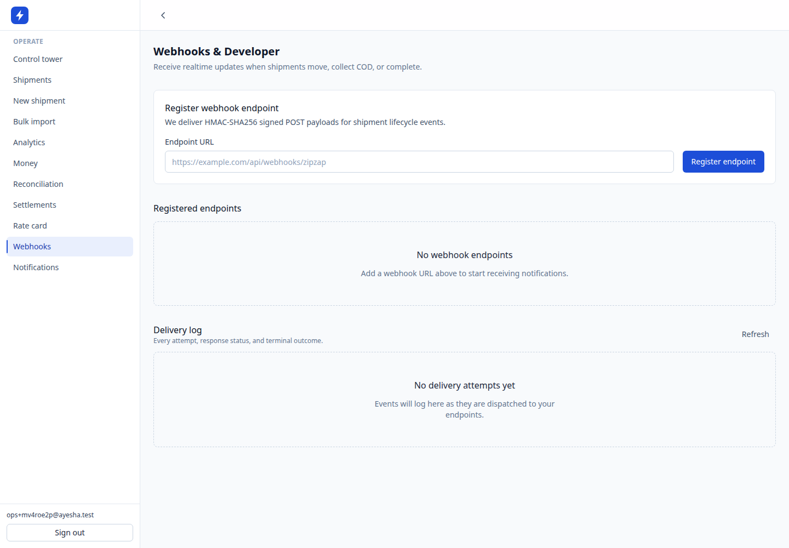
  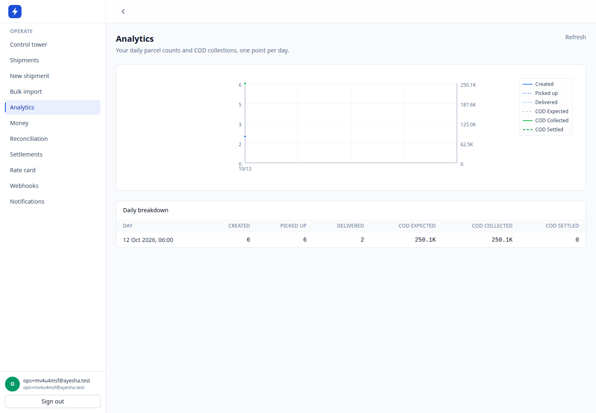
</p>

<p align="center">
  <em>Webhooks with a per-attempt delivery log, and analytics over the same event stream.</em>
</p>

### Operations

<p align="center">
  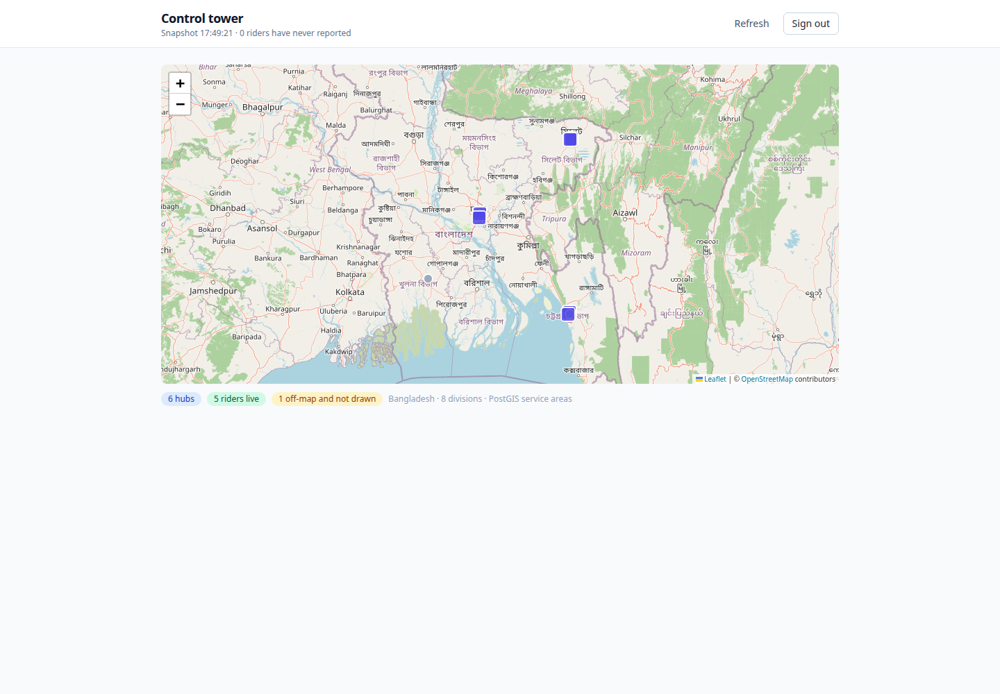
</p>

<p align="center">
  <em>The control tower on Leaflet and OpenStreetMap. Markers are drawn by the app from coordinates
  the API returned; the basemap is a decoration layer, and when it stops answering the screen
  swaps itself to a list rather than leaving an operator with a grey rectangle. "6 riders have never
  reported" is stated rather than hidden — a rider who stops checking in is grey, not red, because
  an ops console that paints everything red stops being read.</em>
</p>

<p align="center">
  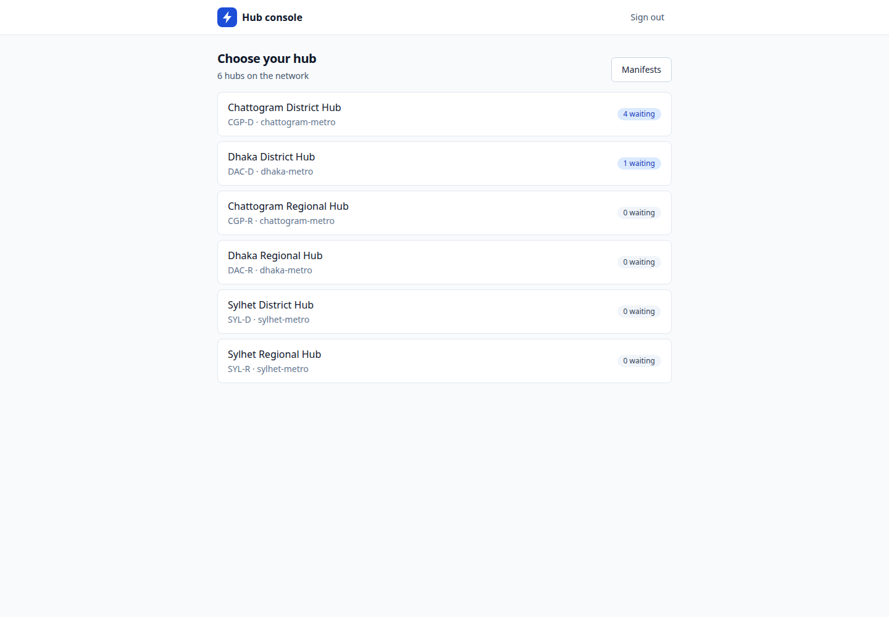
</p>

<p align="center">
  <em>The hub console, signed in as an operator whose only write scope is <code>hub:scan</code>.</em>
</p>

### Rider

<p align="center">
  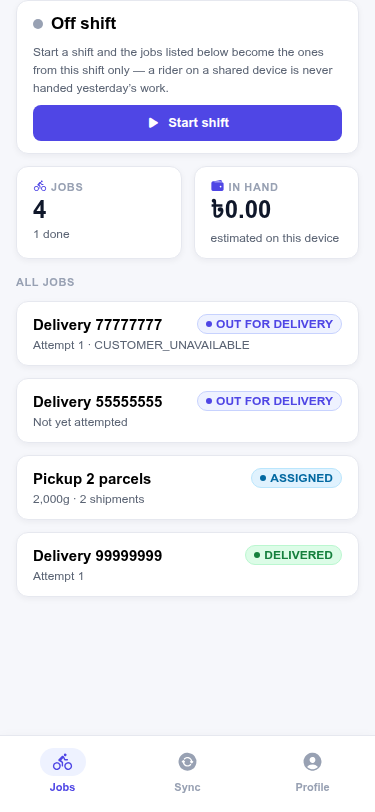
  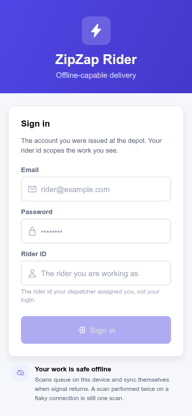
</p>

<p align="center">
  <em>Left: the shift feed. Right: the sign-in a rider actually meets — a mobile number, not an
  email. A rider in Dhaka is issued a SIM card at the depot, not a mailbox, and two people typing
  the same credentials is indistinguishable from one person on two devices. Every write appends to
  a durable offline queue; on reconnect it replays in order and the server's ruling is shown next
  to the believed state, including when it disagrees.</em>
</p>

### Docs

<p align="center">
  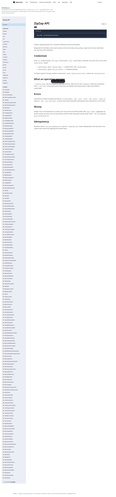
</p>

<p align="center">
  <em>The API reference is generated from the same spec the typed client is generated from, so it
  cannot drift from the implementation.</em>
</p>

---

## Run it

```bash
git clone https://github.com/mahabubone/zipzap && cd zipzap
pnpm install
cp .env.example .env

docker compose -f infra/compose/docker-compose.yml up -d   # postgres · redis · nats
pnpm db:migrate && pnpm db:seed                            # prints three logins
pnpm dev                                                    # API :3000 · web :5173
```

Or the whole product, in containers, in one command:

```bash
pnpm demo:up      # migrate + seed · api · worker · publisher · console · public tracking
```

The seed prints a merchant, a hub operator and an operations manager — three principals with
deliberately different scopes, because one account cannot photograph a system that separates
tenants. Full setup: [`docs/development/environment.md`](docs/development/environment.md).

---

## Status

**Working system, not a plan.** Seventeen domain modules, one deployable, three entrypoints,
`2,396` unit tests and `106` integration assertions against real Postgres, Redis and NATS.

| Phase | Scope                                                       | State       |
| ----- | ----------------------------------------------------------- | ----------- |
| 0     | Foundation — repo, docs, ADRs, infra, CI                    | done        |
| 1     | Identity · merchant · shipment · tracking                   | done        |
| 2     | Pickup · rider · hub · manifest · delivery · returns        | done        |
| 3     | COD · ledger · settlement                                   | done        |
| 4     | Public API · webhooks · bulk import · notifications         | done        |
| 5     | PostGIS · routing · SLA · rider optimization · offline sync | done        |
| 6     | Control tower · analytics · simulation                      | in progress |

### By the numbers

|                                                     |                          |
| --------------------------------------------------- | ------------------------ |
| Domain modules, each owning its own Postgres schema | **17**                   |
| HTTP operations in the generated OpenAPI spec       | **88**                   |
| Unit tests                                          | **2,396** across 115     |
| Integration assertions on real Postgres/Redis/NATS  | **106**                  |
| Reviewed migrations, each reversible                | **49**                   |
| Architecture decision records                       | **17**                   |
| Screens in [`shots/`](shots/), all regenerable      | **40** across 5 apps     |
| Code                                                | ~92k lines of TypeScript |

---

## Stack

NestJS 12 · TypeORM 1.1 · PostgreSQL 18 + PostGIS · Redis · NATS JetStream · BullMQ ·
React 19 · TanStack Router/Query/Table · Expo · Astro 7 · OpenTelemetry · pnpm + turbo

Versions are pinned and the reasoning behind each is written down — see
[`docs/architecture/overview.md`](docs/architecture/overview.md).

---

## Layout

```text
apps/backend          NestJS — 17 domain modules, 3 entrypoints (api/worker/publisher)
apps/frontends/*      merchant-web · customer-tracking · control-tower · hub-console
apps/mobile-rider     Expo rider app (offline-capable)
apps/site             Astro — landing page + developer docs
packages/ui           shared React components
packages/api-client   generated from the backend OpenAPI spec
infra/compose         local postgres · redis · nats · prometheus · grafana
docs/                 product · architecture · domains · api · operations · development · ADR
shots/                screenshots — the visual memory, regenerated by `pnpm shots`
```

---

## Principles

Five rules, in priority order. Everything else is negotiable; these are not.

1. PostgreSQL is the transactional source of truth.
2. Modules own their data and their business rules.
3. Cross-module communication is an explicit contract — never an accidental table join.
4. Events describe facts; jobs do work.
5. Microservices are an extraction strategy, not a starting architecture.

**Money is integer minor units**, everywhere, including tests. **Every mutation writes an outbox
row in the same transaction.** **`Idempotency-Key` is mandatory** on the six operations where a
retry duplicates real work. **A status column is never `UPDATE`d directly** — it changes only
through a transition that validates the current state.

### These rules are enforced, not documented

Architecture that lives only in a README decays. Four gates make the boundaries real:

```bash
pnpm boundaries:check    # cross-schema query, framework import in rules/, provider wire format
                         # escaping its adapter, a float assigned to a money-shaped name
```

A zero-dependency checker that fails CI on any of those. 194 lines, and the highest-leverage file
in the repository — see
[ADR-0002](docs/ADR/0002-postgresql-schema-boundaries.md).

```bash
pnpm api:check           # the spec and the generated client are committed; CI fails on drift
```

Thirty-two hand-written response DTOs were deleted when that landed. The OpenAPI spec is generated
from the controllers; the typed client is generated from the spec; a CI step regenerates both and
fails if the diff is non-empty. Three kinds of stale contract are impossible at once, which is the
only way any of them are reliably impossible.

---

## CI

```text
format → boundaries → typecheck → unit tests → build
       → migrate up → migrate DOWN → migrate up
       → integration tests → contract artefacts current → API contract tests
```

`migrate down` is in there on purpose: a migration that cannot roll back is a migration that cannot
be deployed safely. Postgres, Redis, NATS and PostGIS are all real services in the job — including a
`SELECT postgis_version()` healthcheck, because the spatial layer is load-bearing and "accepts
connections" is not the same as "works".

---

## Documentation

|              |                                                                                              |
| ------------ | -------------------------------------------------------------------------------------------- |
| Product      | [`docs/product/`](docs/product/) — vision, personas, competition, roadmap                    |
| Architecture | [`docs/architecture/overview.md`](docs/architecture/overview.md) — modules, boundaries, flow |
| Domains      | [`docs/domains/`](docs/domains/) — one file per business domain                              |
| ADRs         | [`docs/ADR/`](docs/ADR/) — every architectural decision, with its alternatives               |
| API          | [`docs/api/`](docs/api/) — authentication, versioning, errors, webhooks                      |
| Development  | [`docs/development/environment.md`](docs/development/environment.md) — setup and commands    |
| Testing      | [`docs/testing/`](docs/testing/) — strategy, fixtures, conventions                           |
| Operations   | [`docs/operations/`](docs/operations/) — deployment, observability, runbooks                 |

Working agreements for both humans and agents: [`AGENTS.md`](AGENTS.md).

---

## What is not built

Stated plainly, because a portfolio that only lists its strengths is telling you something.

- **Support, admin and developer-portal consoles** are planned and absent — no packages exist.
- **The rider's native bundle does not build.** `expo export --platform ios` fails inside
  `react-native-screens`; the web export used for these screenshots is the only bundle.
- **No deployment beyond `docker compose`.** No Kubernetes, no Terraform, no blue-green.
- **The rider app is served over HTTP on a shared device model**; there is no device attestation.

---

## License

MIT — see [LICENSE](LICENSE).
