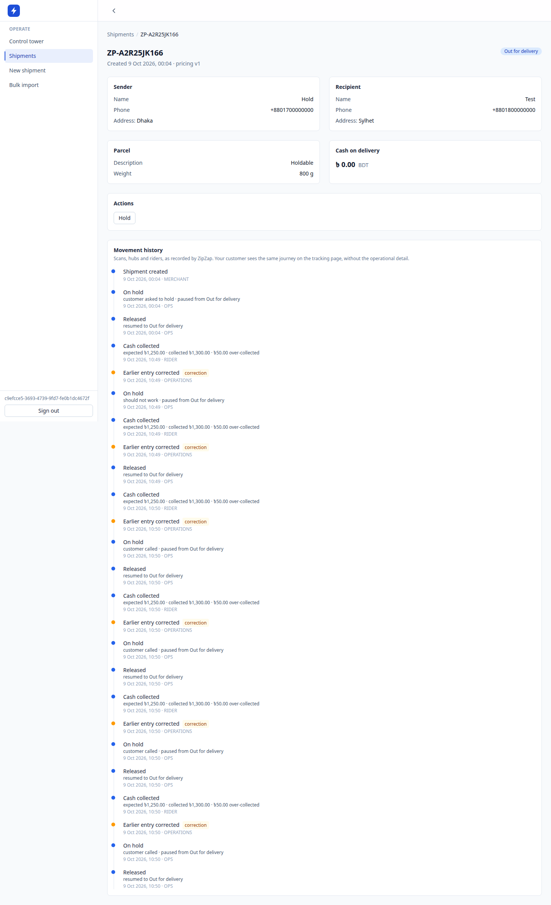
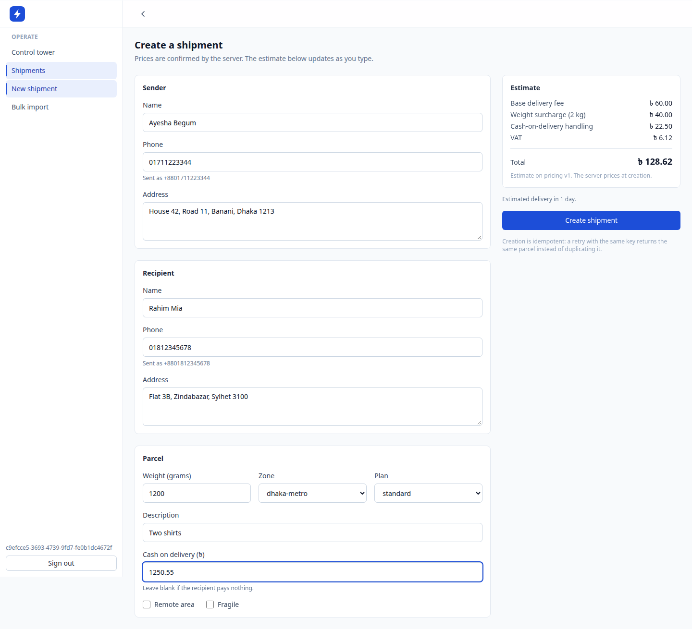
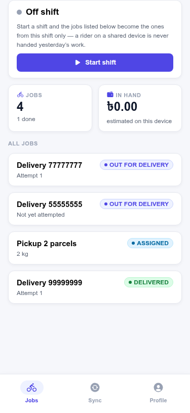

# ZipZap

**A logistics operating system for e-commerce fulfillment and last-mile delivery.**

Not a parcel tracker. ZipZap is the internal operating platform of a courier business —
merchant onboarding through COD reconciliation to settlement — in one deployable modular
monolith. Built for Bangladesh first; the courier vertical is the first, not the only, case.

```text
Merchant ─► Shipment ─► Pickup ─► Origin hub ─► Line-haul ─► Destination hub
                                                                    │
      Settlement ◄── COD ◄── Delivered ◄── Last mile ◄── Out for delivery
```

<p align="center">
  
</p>

---

## Status

**Working system, not a plan.** Seventeen domain modules, one deployable, three entrypoints,
`2,396` unit tests and `106` integration assertions green. The vertical a merchant actually pays
for runs end to end: create a shipment, see it priced, hand it to a rider, watch it move through
two hubs, capture proof of delivery, collect the cash, settle the payout.

| Phase | Scope                                                       | State       |
| ----- | ----------------------------------------------------------- | ----------- |
| 0     | Foundation — repo, docs, ADRs, infra, CI                    | done        |
| 1     | Identity · merchant · shipment · tracking                   | done        |
| 2     | Pickup · rider · hub · manifest · delivery · returns        | done        |
| 3     | COD · ledger · settlement                                   | done        |
| 4     | Public API · webhooks · bulk import · notifications         | done        |
| 5     | PostGIS · routing · SLA · rider optimization · offline sync | done        |
| 6     | Control tower · analytics · simulation                      | in progress |

### By the numbers

|                                                     |                            |
| --------------------------------------------------- | -------------------------- |
| Domain modules, each owning its own Postgres schema | **17**                     |
| HTTP operations in the generated OpenAPI spec       | **88**                     |
| Unit tests                                          | **2,396** across 115 files |
| Integration assertions on real Postgres/Redis/NATS  | **106**                    |
| Reviewed migrations, each reversible                | **49**                     |
| Architecture decision records                       | **17**                     |
| Code                                                | ~92k lines of TypeScript   |

---

## The demo

One event, five surfaces, at the same moment. This is the acceptance test for the architecture,
not just the product: a parcel scan at a hub has to appear on the merchant's shipment detail, the
operations control tower, the rider's next job, the customer's public tracking page, and the
financial dashboard — without any of those five reading another's tables.

<p align="center">
  
</p>

The rider app is offline-first and reconciles on reconnect:

<p align="center">
  
</p>

### Run it

```bash
git clone https://github.com/mahabubone/zipzap && cd zipzap
pnpm install
docker compose -f infra/compose/docker-compose.yml up -d   # postgres · redis · nats
pnpm db:migrate
pnpm dev                                                   # API :3000 · web :5173
```

Three backend processes, from one codebase — `main.ts` (API), `worker.ts` (BullMQ + NATS
consumers), `publisher.ts` (the only thing that publishes to NATS). The worker is not optional:
`tracking.public_timeline` is a projection the worker builds, so `/track/:code` 404s for a fresh
shipment without it. That is the architecture showing through, not a bug.

Full setup, including the `.env` you will need: [`docs/development/environment.md`](docs/development/environment.md).

---

## Stack

NestJS 12 · TypeORM 1.1 · PostgreSQL 18 + PostGIS · Redis · NATS JetStream · BullMQ ·
React 19 · TanStack Router/Query/Table · Expo · Astro 7 · OpenTelemetry · pnpm + turbo

Versions are pinned, and the reasoning behind each is written down — see
[`docs/architecture/overview.md`](docs/architecture/overview.md).

---

## Layout

```text
apps/backend          NestJS — 17 domain modules, 3 entrypoints (api/worker/publisher)
apps/frontends/*      merchant-web · customer-tracking · control-tower · hub-console
apps/mobile-rider     Expo rider app (offline-capable)
apps/site             Astro — landing page + developer docs
packages/ui           shared React components
packages/api-client   generated from the backend OpenAPI spec
infra/compose         local postgres · redis · nats · prometheus · grafana
docs/                 product · architecture · domains · api · operations · development · ADR
shots/                screenshots — the visual memory of every surface
```

---

## Principles

Five rules, in priority order. Everything else is negotiable; these are not.

1. PostgreSQL is the transactional source of truth.
2. Modules own their data and their business rules.
3. Cross-module communication is an explicit contract — never an accidental table join.
4. Events describe facts; jobs do work.
5. Microservices are an extraction strategy, not a starting architecture.

**Money is integer minor units**, everywhere, including tests: `125050` poisha, never `1250.50`,
never a float. **Every mutation writes an outbox row in the same transaction.** **`Idempotency-Key`
is mandatory** on the six operations where a retry duplicates real work.

### These rules are enforced, not documented

Architecture that lives only in a README decays. Two gates make the boundaries real:

```bash
pnpm boundaries:check
```

A zero-dependency checker that fails CI on a cross-schema query, a framework import inside a
`rules/` directory, a provider's wire format escaping its adapter, or a float assigned to a
money-shaped name. It is 194 lines and it is the highest-leverage file in the repository — see
[`docs/ADR/0002-postgresql-schema-boundaries.md`](docs/ADR/0002-postgresql-schema-boundaries.md).

The second gate is the contract drift check: the OpenAPI spec and the generated client are
committed, and CI regenerates both and fails if the diff is non-empty. Thirty-two hand-written
response DTOs were deleted when that landed.

---

## CI

```text
format → boundaries → typecheck → unit tests → build
       → migrate up → migrate DOWN → migrate up
       → integration tests → contract artefacts current → API contract tests
```

`migrate down` is in there on purpose: a migration that cannot roll back is a migration that
cannot be deployed safely. Postgres, Redis, NATS and PostGIS are all real services in the job —
including a `SELECT postgis_version()` healthcheck, because the spatial layer is load-bearing and
"accepts connections" is not the same as "works".

---

## Documentation

|              |                                                                                              |
| ------------ | -------------------------------------------------------------------------------------------- |
| Product      | [`docs/product/`](docs/product/) — vision, personas, competition, roadmap                    |
| Architecture | [`docs/architecture/overview.md`](docs/architecture/overview.md) — modules, boundaries, flow |
| Domains      | [`docs/domains/`](docs/domains/) — one file per business domain                              |
| ADRs         | [`docs/ADR/`](docs/ADR/) — every architectural decision, with its alternatives               |
| API          | [`docs/api/`](docs/api/) — authentication, versioning, errors, webhooks                      |
| Development  | [`docs/development/environment.md`](docs/development/environment.md) — setup and commands    |
| Testing      | [`docs/testing/`](docs/testing/) — strategy, fixtures, conventions                           |
| Operations   | [`docs/operations/`](docs/operations/) — deployment, observability, runbooks                 |

Working agreements for both humans and agents: [`AGENTS.md`](AGENTS.md).

---

## License

MIT — see [LICENSE](LICENSE).
