<div align="center">

# ⚡ ZipZap

### The logistics operating system a courier business actually runs on

**Merchant ordering → pickup → two hubs → line-haul → last mile → cash → settlement**
in one deployable, with five surfaces reading one event stream.

<br/>

[](LICENSE)
[](https://www.typescriptlang.org/)
[](https://nestjs.com)
[](https://www.postgresql.org/)

_Cash-on-delivery, where the courier holds the customer's money in trust and the money is the risk._

</div>

---

## 🎯 Why this exists

Not a parcel tracker — a parcel tracker is a lookup box. This is the internal operating platform of
a courier business: the thing a merchant, a rider, a hub operator and a finance team all work inside
of, every day, to move a box from a shop door to a customer's hand and get the money back.

It exists for two reasons.

**The product reason.** Cash-on-delivery is most orders in this market. The courier holds the
customer's money in trust from the moment a parcel is handed over, reconciles it against what was
quoted, and pays it out once the merchant has settled. That is the whole business, and it is where
the risk lives: a system that treats cash as an afterthought is one lost parcel away from an
unrecoverable one. ZipZap models the money as carefully as it models the transport.

**The engineering reason.** The interesting problem is simultaneity. One parcel scan has to appear at
that instant in five places — the merchant's detail view, the operations control tower, the rider's
next job, the customer's public tracking page, and the financial dashboard — and **none of those five
may read another's tables.** That constraint is the whole design, and it is the thing this repository
is a demonstration of.

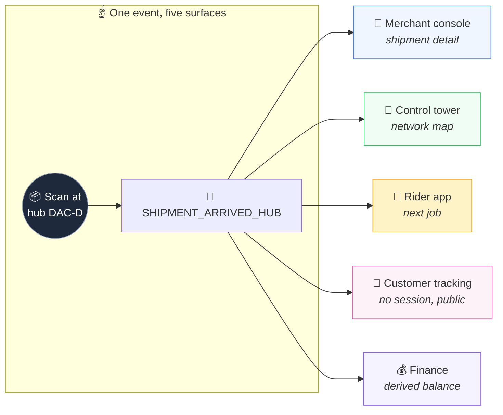

Five surfaces. One stream. No cross-schema JOIN anywhere — which is the only reason the diagram
above is true and not aspirational.

---

## :construction: Our Technology Stack

**Architecture**: Event-Driven Architecture (EDA) with CQRS logically separated, Transactional outbox pattern & premature microservices ready to extract when needed. Also, this codebase is monorepo with tools like pnpm & turbo.

**Authentication**: JWT based

**Authorization**: Role-based access control (RBAC) with scoped permissions

**Frontend**: React, TanStack Start, Expo (React Native), and Astro.js (for content site only), TailwindCSS.

**Backend**: NestJS, TypeORM, OpenAPI & RESTful APIs

**Database**: PostgreSQL x PostGIS, Redis, NATS JetStream

**Event Bus**: NATS JetStream

**Message Queue**: BullMQ

**Cache**: Redis

**Monitoring**: OpenTelemetry compatible

**Logging**: OpenTelemetry compatible

**Version Control**: Git

> [!NOTE]
> This repository is a demonstration of the architecture. It is not a production-ready system. Also, I did care about backend much more than our frontends and mobile etc. applications in terms of UI-design to UX enriching. Focusing on them cloud take a lot of time I don't have right now.

---

## 🚀 Run it

```bash
git clone https://github.com/mahabubone/zipzap && cd zipzap
pnpm install
cp .env.example .env

# Infrastructure, then the whole product in containers
docker compose -f infra/compose/docker-compose.yml up -d
pnpm db:migrate && pnpm db:seed      # prints three logins
pnpm dev                             # API :3000 · web :5173
```

Or one command, full stack, nothing else to configure:

```bash
cp .env.example .env && pnpm demo:up
```

The seed prints a merchant, a hub operator and an operations manager — three principals with
deliberately different scopes, because one account cannot demonstrate a system that separates
tenants. [`docs/development/environment.md`](docs/development/environment.md)

---

## 🧭 The end-to-end flow

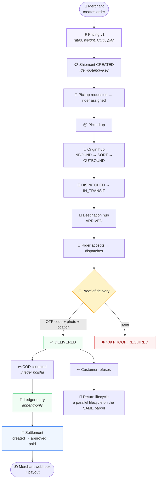

Every arrow is a real state transition in [`state-machine.ts`](apps/backend/src/modules/shipment/rules/state-machine.ts),
validated rather than written: a status column is never `UPDATE`d directly, it changes only through a
transition that checks the current state.

---

## 🏛️ Architecture: one deployable, seventeen owners

A modular monolith. Microservices are an extraction strategy, never a starting point.

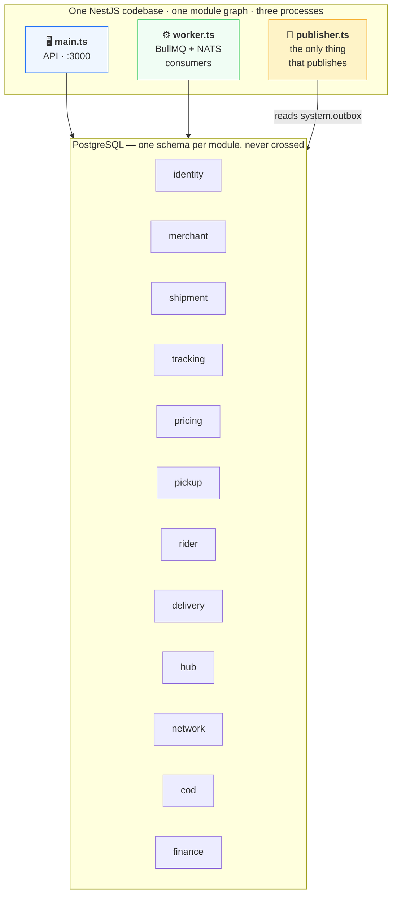

Seventeen modules, each owning its own Postgres schema, each unreachable from any other by SQL. The
rule is enforced by a checker that runs before every commit, not promised in a README.

---

## 🔁 How an event travels

The transactional outbox is the spine. Every mutation writes its outbox row **in the same
transaction** as the change it describes, so the event and the fact can never disagree.

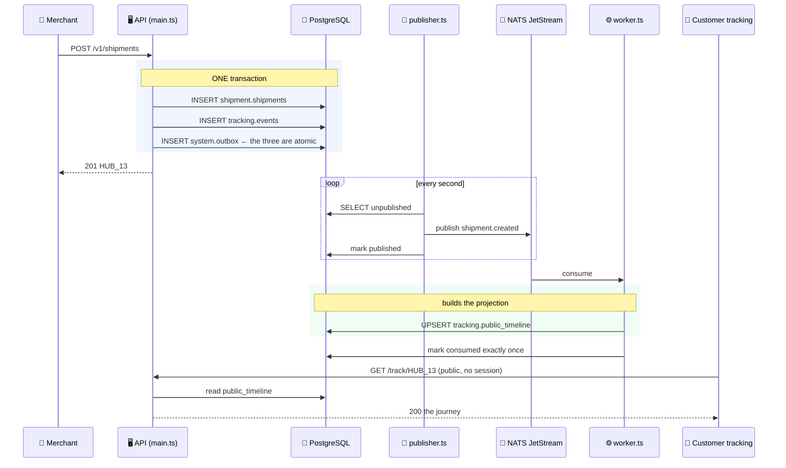

This is why the worker must be running: `tracking.public_timeline` is a **projection the worker
builds**, so `/track/:code` 404s for a fresh parcel if only the API is up. That is the architecture
showing through, not a defect.

---

## 📐 The money rules

Cash-on-delivery is where a logistics system either earns trust or loses it. Three rules, each
enforced in a place that cannot be forgotten.


| Rule                    | Where it lives                            | Why it cannot be skipped                                                                                                     |
| ----------------------- | ----------------------------------------- | ---------------------------------------------------------------------------------------------------------------------------- |
| **Integer minor units** | `common/money.ts`, and `@MoneyMinor` DTOs | 151 test cases guard it. `MoneyText` had a float-division bug caught by a test comparing against the backend's own formatter |
| **Append-only ledger**  | DB trigger rejects UPDATE/DELETE          | A correction is a compensating row. There is no API to edit history                                                          |
| **Derived balances**    | `finance` sums its ledger                 | The balance column is not stored, so there is nothing to corrupt. The screen shows the lines that made it up                 |
| **Settlement blocker**  | `COD_LOOKUP`, read before the freeze      | Cash in transit cannot be frozen, so a settlement cannot be created against money that has not landed                        |

---

## 🛠️ Stack, and why each choice

| Layer             | Choice                                      | The reason, not the list                                                                                                                                                                          |
| ----------------- | ------------------------------------------- | ------------------------------------------------------------------------------------------------------------------------------------------------------------------------------------------------- |
| **Runtime**       | Node 24 · pnpm 11 · Turbo 2.11              | Strict ESM and a workspace graph, so a package cannot import another's internals by accident                                                                                                      |
| **Backend**       | NestJS 12                                   | Dependency injection with real module boundaries — `forModule('identity', [...])` scopes a connection per module, which makes a cross-schema query _fail at runtime_ rather than degrade silently |
| **ORM**           | TypeORM 1.1                                 | `synchronize: false` permanently. Every schema change is a reviewed, reversible migration — the gate runs `db:migrate`, `db:revert`, `db:migrate` on every push                                   |
| **Database**      | PostgreSQL 18 + PostGIS                     | Coverage, service areas and routing are spatial. A healthcheck runs `SELECT postgis_version()`, because "accepts connections" is not "works"                                                      |
| **Async**         | NATS JetStream · BullMQ · Redis             | NATS says _what happened_; BullMQ _does the work_; Redis holds rate limits and idempotency and is **never** authoritative                                                                         |
| **Language**      | TypeScript 6.0                              | Pinned deliberately. TypeScript 7 ships `tsc` only with no programmatic API, which breaks `@nestjs/cli` builds                                                                                    |
| **Web**           | React 19 · TanStack Router/Start            | One codebase, SSR. The auth guard runs in `beforeLoad` _on the server_, so an unauthenticated visitor gets a 307 rather than a flash of console                                                   |
| **Design system** | `packages/ui`                               | 52 components, 338 tests, and Storybook. A screen that is not in the kit does not get built                                                                                                       |
| **Mobile**        | Expo / React Native                         | Offline-first queue with per-command idempotency                                                                                                                                                  |
| **Docs**          | Astro 7                                     | The API reference is generated from the same spec the typed client is generated from, so it cannot drift                                                                                          |
| **Observability** | OpenTelemetry · Prometheus · Grafana · pino | The publisher and worker expose metrics; the correlation is `request_id`                                                                                                                          |

Full reasoning, with the alternatives that were rejected, lives in
[`docs/architecture/overview.md`](docs/architecture/overview.md) and
[17 ADRs](docs/ADR/).

---

## 🧪 What proves it works

```bash
pnpm verify               # boundaries → format → typecheck → 2,411 unit tests
pnpm test:integration     # 106 assertions on real Postgres, Redis and NATS
pnpm boundaries:check     # the architecture gate
```

|                                               |                          |
| --------------------------------------------- | ------------------------ |
| Domain modules, each owning a Postgres schema | **17**                   |
| HTTP operations in the generated OpenAPI spec | **88**                   |
| Unit tests                                    | **2,411**                |
| Integration assertions on live infrastructure | **106**                  |
| Reviewed, reversible migrations               | **50**                   |
| Architecture decision records                 | **17**                   |
| Screenshots, all regenerable by `pnpm shots`  | **40** across 5 apps     |
| Code                                          | ~92k lines of TypeScript |

### The gates, and what they actually prevent

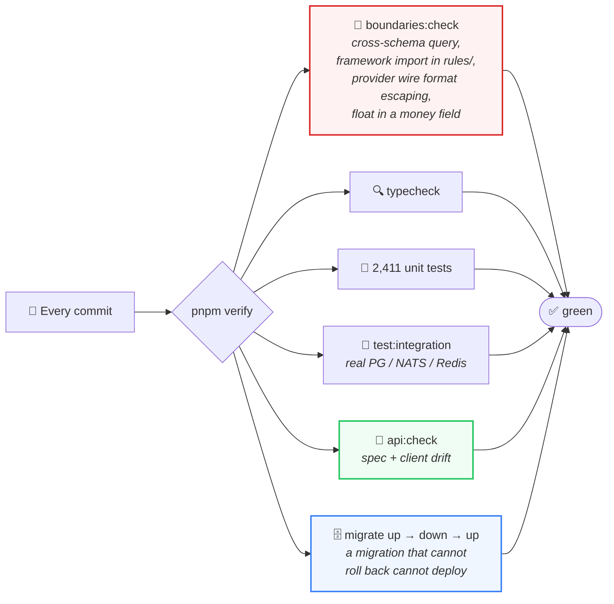

`boundaries:check` is 194 lines of zero-dependency JavaScript and the highest-leverage file in the
repository: it fails the gate on the failure modes this architecture is most at risk of, all of which
are invisible to a human reading a small diff.

---

## 🖼️ Surfaces

### The merchant console

<p align="center">
  
</p>

<p align="center">
  <em>Twelve events, every one attributed — merchant, operations or rider. The history is append-only:
  a correction is a new row, never an edit.</em>
</p>

<p align="center">
  
  
</p>

<p align="center">
  <em>Left: the merchant. Right: the customer — same parcel, no session, a different app on a
  different origin, one event stream underneath.</em>
</p>

<p align="center">
  
  
</p>

<p align="center">
  <em>Live server pricing with a coverage check before the write · a balance <b>derived</b> from an
  append-only ledger, never a stored column, with the lines that made it up shown on screen.</em>
</p>

### Operations

<p align="center">
  
</p>

<p align="center">
  <em>Leaflet on OpenStreetMap. Markers are drawn by the app from coordinates the API returned; the
  basemap is decoration, and when it stops answering the screen swaps itself to a list rather than
  leaving an operator with a grey rectangle. "6 riders have never reported" is stated rather than
  hidden — a rider who stops checking in goes grey, not red, because an ops console that paints
  everything red stops being read.</em>
</p>

<p align="center">
  
</p>

<p align="center">
  <em>The hub console, signed in as an operator whose only write scope is <code>hub:scan</code>.</em>
</p>

### Rider

<p align="center">
  
  
</p>

<p align="center">
  <em>Left: the shift feed, cash in hand. Right: the sign-in a rider actually meets — a mobile
  number, not an email. A rider in Dhaka is issued a SIM card at the depot, not a mailbox, and two
  people typing the same credentials is indistinguishable from one person on two devices. Every write
  appends to a durable offline queue; on reconnect it replays in order and the server's ruling is
  shown next to the believed state, including when it disagrees.</em>
</p>

### Docs

<p align="center">
  
</p>

<p align="center">
  <em>Generated from the same spec the typed client is generated from — so its presence is evidence
  the contract is current, not a hand-written page that drifted months ago.</em>
</p>

---

## 📚 Documentation

|                       |                                                                                              |
| --------------------- | -------------------------------------------------------------------------------------------- |
| 🎯 Product            | [`docs/product/`](docs/product/) — vision, personas, competition, roadmap                    |
| 🏛️ Architecture       | [`docs/architecture/overview.md`](docs/architecture/overview.md) — modules, boundaries, flow |
| 🧩 Domains            | [`docs/domains/`](docs/domains/) — one file per business domain                              |
| 📜 ADRs               | [`docs/ADR/`](docs/ADR/) — 17 decisions, each with the alternatives rejected                 |
| 🔌 API                | [`docs/api/`](docs/api/) — auth, versioning, errors, webhooks, pagination                    |
| 🧪 Testing            | [`docs/testing/`](docs/testing/) — strategy, fixtures, conventions                           |
| 🚀 Operations         | [`docs/operations/`](docs/operations/) — deployment, observability, runbooks                 |
| 🤖 Working agreements | [`AGENTS.md`](AGENTS.md) — for humans and AI agents both                                     |

### The ADRs worth reading first

| #                                                     | Decision                                                  |
| ----------------------------------------------------- | --------------------------------------------------------- |
| [0001](docs/ADR/0001-modular-monolith.md)             | Modular monolith over microservices                       |
| [0002](docs/ADR/0002-postgresql-schema-boundaries.md) | One schema per module, no cross-schema access             |
| [0005](docs/ADR/0005-transactional-outbox.md)         | Transactional outbox for event publication                |
| [0009](docs/ADR/0009-money-representation.md)         | Integer minor units + currency                            |
| [0010](docs/ADR/0010-idempotency.md)                  | Mandatory `Idempotency-Key` on money and physical actions |
| [0012](docs/ADR/0012-rider-offline-sync.md)           | Offline queue with per-command idempotency                |
| [0016](docs/ADR/0016-http-only-sessions.md)           | HttpOnly sessions behind a same-origin proxy              |
| [0017](docs/ADR/0017-integration-test-harness.md)     | Integration tests wire their graph through one harness    |

---

## ⚠️ What is not built

Stated plainly, because a portfolio that only lists its strengths is telling you something.

- **Support, admin and developer-portal consoles** are planned and absent — no packages exist.
- **The rider's native bundle does not build.** `expo export --platform ios` fails inside
  `react-native-screens`; the web export used for these screenshots is the only bundle.
- **No deployment beyond `docker compose`.** No Kubernetes, no Terraform, no blue-green.
- **113 roadmap boxes still open**, concentrated in surfaces, security hardening, observability
  dashboards and load testing.

---

## 🙏 Credits & Contact

**Built and designed by [Mahabub](https://github.com/mahabubone).**

📧 **Email** · `iam.mahabub@proton.me`
💼 **LinkedIn** · `linkedin.com/in/mahabubone`

### Libraries this is built on

[NestJS](https://nestjs.com) · [TypeORM](https://typeorm.io) · [PostgreSQL](https://www.postgresql.org) ·
[PostGIS](https://postgis.net) · [NATS JetStream](https://nats.io) · [BullMQ](https://docs.bullmq.io) · [Redis](https://redis.io) ·
[React](https://react.dev) · [TanStack](https://tanstack.com) · [Expo](https://expo.dev) ·
[Astro](https://astro.build) · [Leaflet](https://leafletjs.com) · [OpenStreetMap](https://www.openstreetmap.org) ·
[Vitest](https://vitest.dev) · [OpenTelemetry](https://opentelemetry.io)

---

## 📸 Every surface, shot by shot

Forty-two screenshots across five applications. **Every one is regenerable** — this is not a curated
gallery: `pnpm shots` rebuilds the whole directory against a running stack, so the images cannot
drift from what the code renders.

```bash
pnpm seed:shots && pnpm shots     # web · hub · ops · site · mobile
```

A few also appear above, next to the commentary they belong to. Where they repeat it is on purpose:
the section above argues, this one indexes.

### 🏪 Merchant console — 21 shots

<tr>
<td width="50%">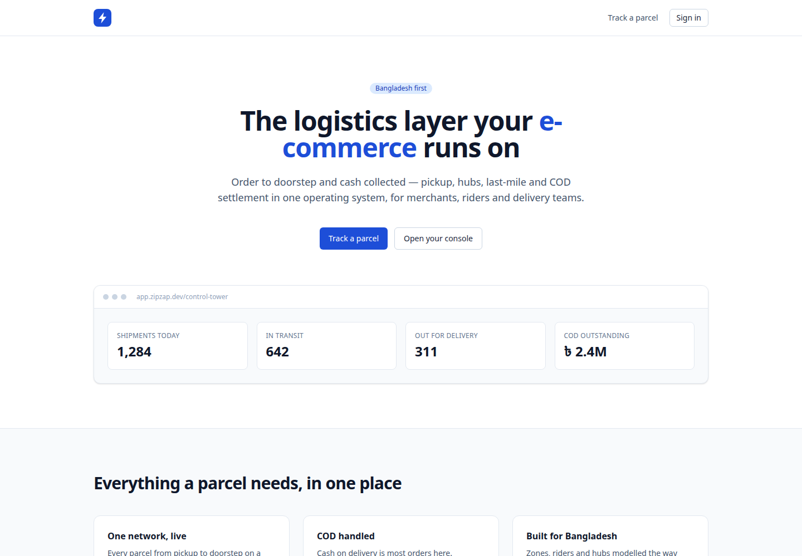</td>
<td width="50%">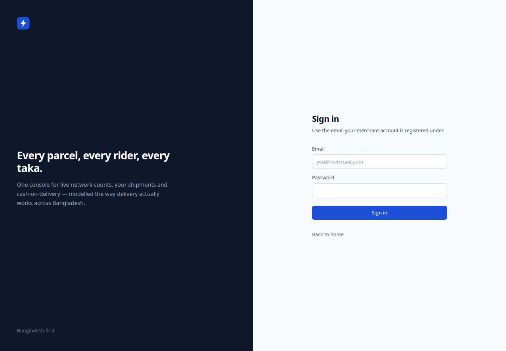</td>
</tr>
<tr>
<td align="center"><sub>Landing — the pitch, before any session</sub></td>
<td align="center"><sub>Sign in — cookie session, no token in storage</sub></td>
</tr>

<tr>
<td width="50%"></td>
<td width="50%">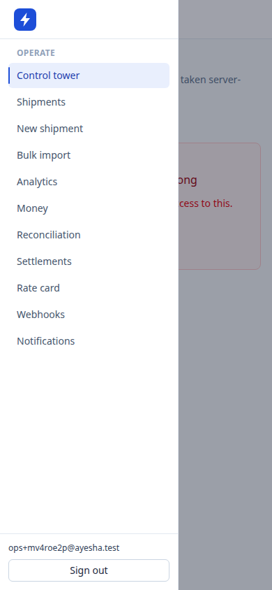</td>
</tr>
<tr>
<td align="center"><sub>The login split at 900px, where the panel hides</sub></td>
<td align="center"><sub>The console at 390px, drawer open</sub></td>
</tr>

<tr>
<td width="50%"></td>
<td width="50%"></td>
</tr>
<tr>
<td align="center"><sub>Six parcels, six lifecycle states</sub></td>
<td align="center"><sub>Twelve-step history, every actor attributed</sub></td>
</tr>

<tr>
<td width="50%">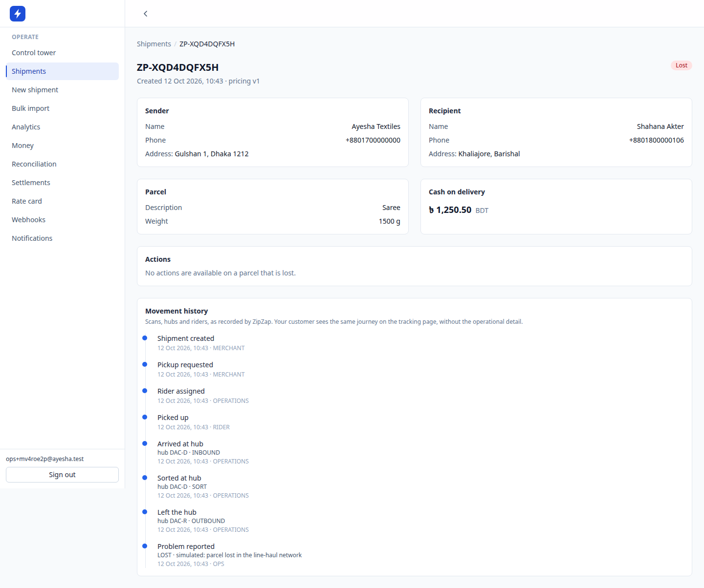</td>
<td width="50%"></td>
</tr>
<tr>
<td align="center"><sub>A lost parcel — actions off, history intact</sub></td>
<td align="center"><sub>Live server pricing and a coverage check</sub></td>
</tr>

<tr>
<td width="50%">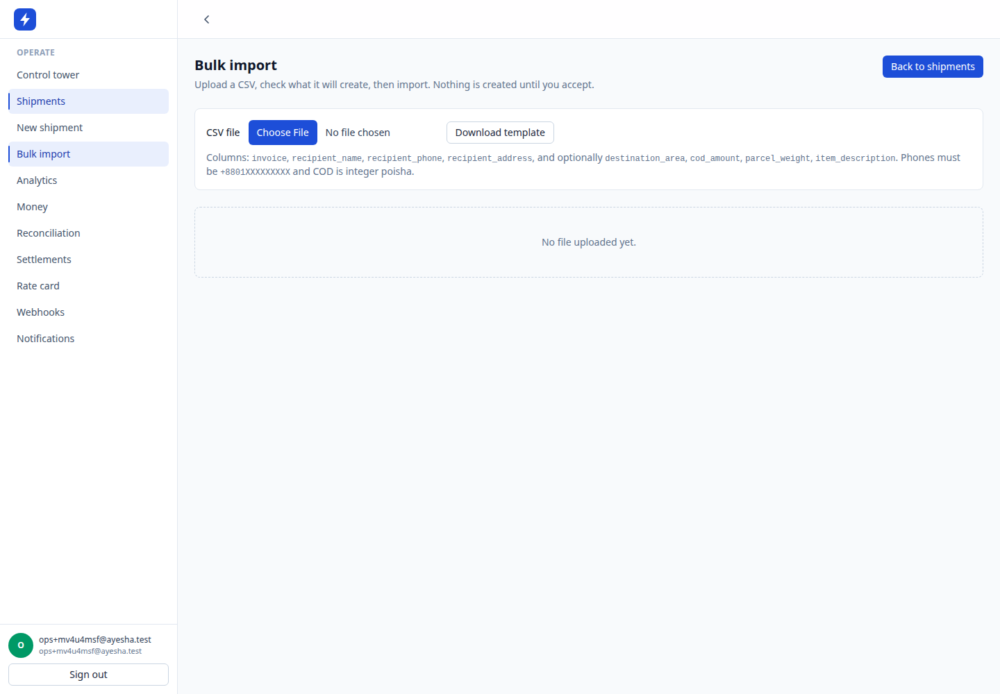</td>
<td width="50%"></td>
</tr>
<tr>
<td align="center"><sub>Bulk import, previewed before it commits</sub></td>
<td align="center"><sub>A balance derived from the ledger, not stored</sub></td>
</tr>

<tr>
<td width="50%">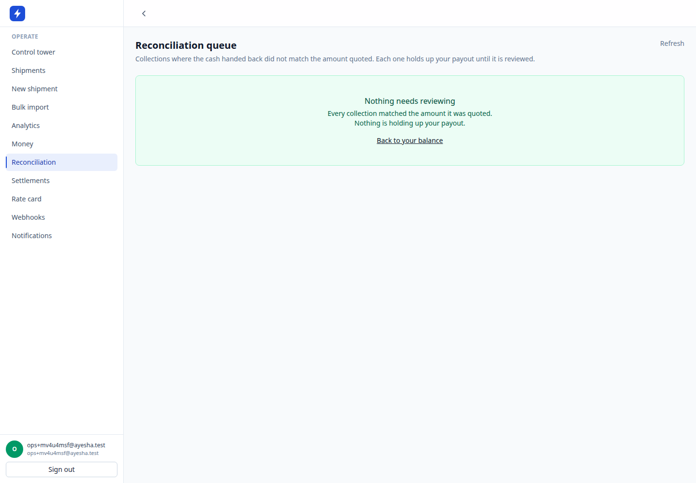</td>
<td width="50%"></td>
</tr>
<tr>
<td align="center"><sub>The reconciliation queue — the empty state is honest</sub></td>
<td align="center"><sub>Settlements, with a downloadable statement</sub></td>
</tr>

<tr>
<td width="50%">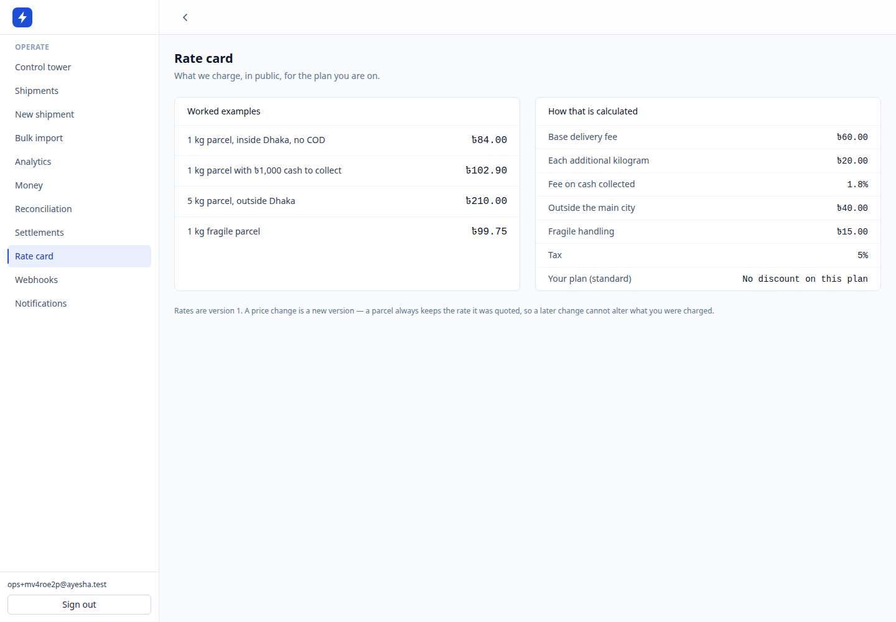</td>
<td width="50%"></td>
</tr>
<tr>
<td align="center"><sub>Rate card, with worked examples</sub></td>
<td align="center"><sub>Analytics over the same event stream</sub></td>
</tr>

<tr>
<td width="50%"></td>
<td width="50%">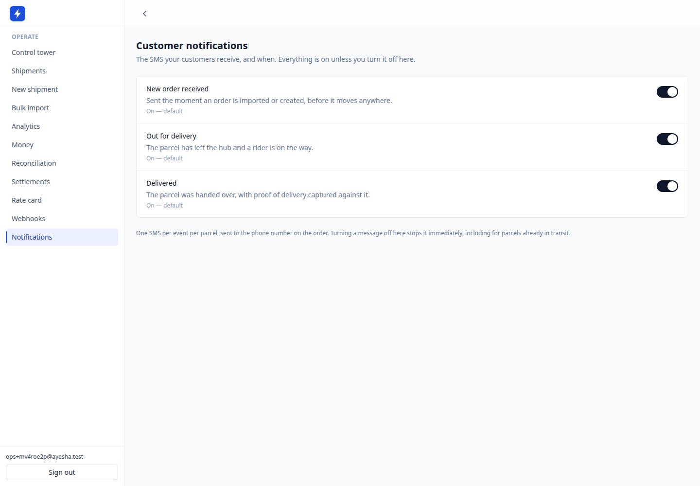</td>
</tr>
<tr>
<td align="center"><sub>Webhooks with a per-attempt delivery log</sub></td>
<td align="center"><sub>Notification preferences, as shipped</sub></td>
</tr>

<tr>
<td width="50%">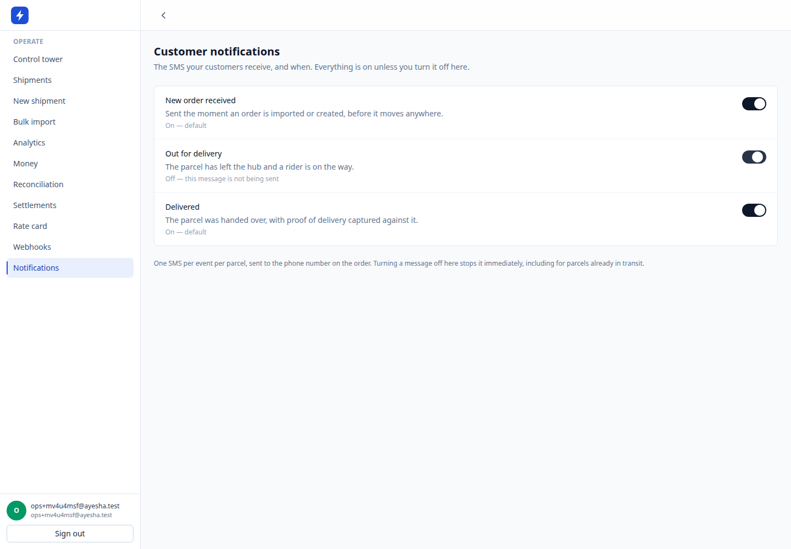</td>
<td width="50%">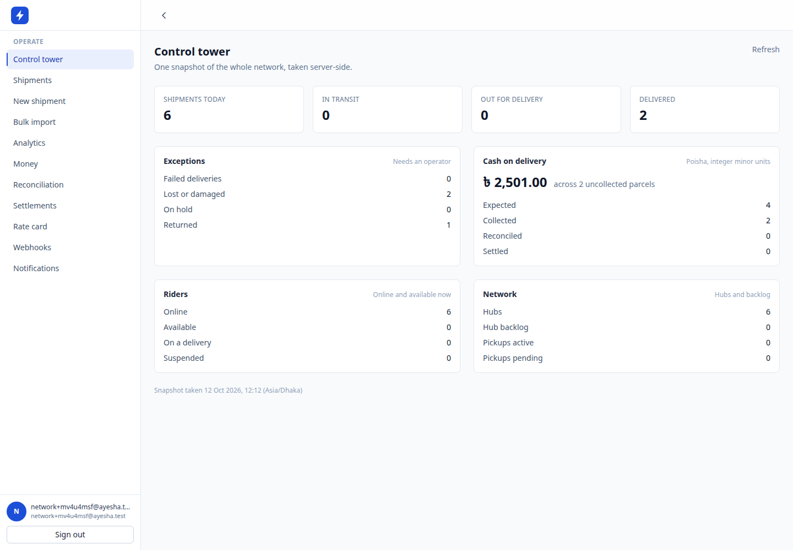</td>
</tr>
<tr>
<td align="center"><sub>The same, toggled to a real merchant state</sub></td>
<td align="center"><sub>Control tower, as an operations manager</sub></td>
</tr>

### 👤 Customer tracking — 4 shots

<tr>
<td width="50%">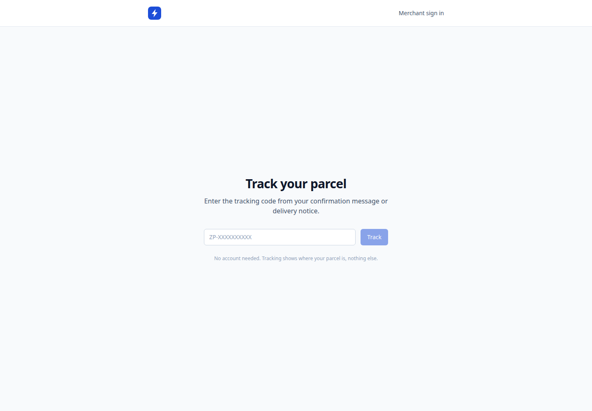</td>
<td width="50%"></td>
</tr>
<tr>
<td align="center"><sub>Enter a code — no account, no session</sub></td>
<td align="center"><sub>The journey, without the operational detail</sub></td>
</tr>

<tr>
<td width="50%">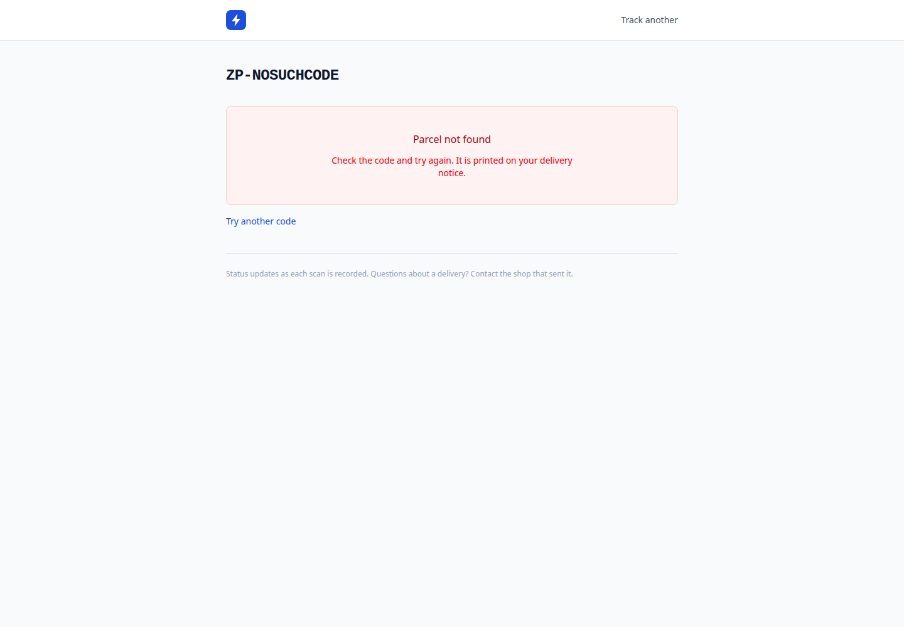</td>
<td width="50%"></td>
</tr>
<tr>
<td align="center"><sub>An unknown code, answered plainly</sub></td>
<td align="center"><sub>The public landing page this ships beside</sub></td>
</tr>

### 📡 Operations — 3 shots

<table>
<tr>
<td width="33%"></td>
<td width="33%">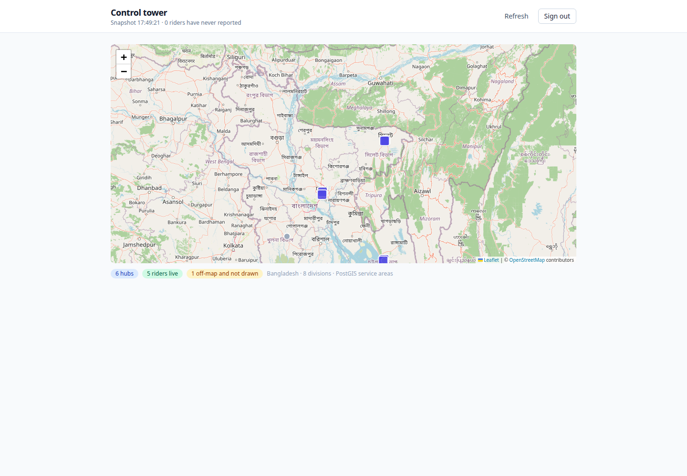</td>
<td width="33%"></td>
</tr>
<tr>
<td align="center"><sub>Whole network, fitted</sub></td>
<td align="center"><sub>Zoomed to where the density is</sub></td>
<td align="center"><sub>One marker hovered — the reason the screen exists</sub></td>
</tr>
</table>

### 🏢 Hub console — 3 shots

<tr>
<td width="50%"></td>
<td width="50%">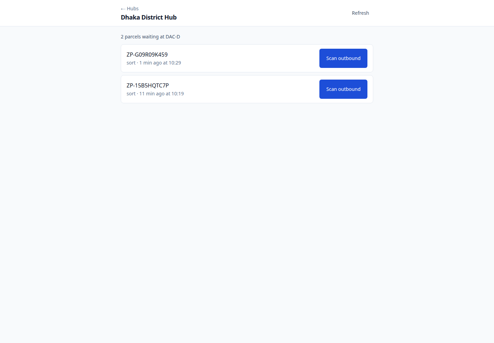</td>
</tr>
<tr>
<td align="center"><sub>Hub picker with a live parcels-waiting count</sub></td>
<td align="center"><sub>Scan-first dock operations for one site</sub></td>
</tr>

<tr>
<td width="50%">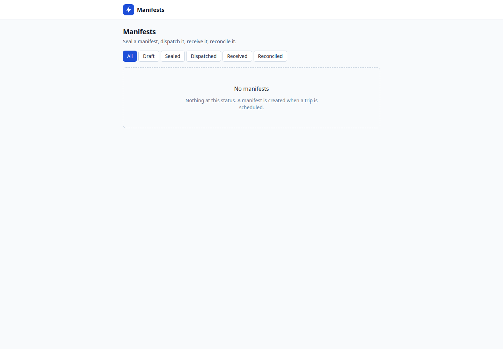</td>
<td width="50%"></td>
</tr>
<tr>
<td align="center"><sub>Route manifests and reconciliation</sub></td>
<td align="center"></td>
</tr>

### 🚴 Rider — 12 shots

<tr>
<td width="50%"></td>
<td width="50%"></td>
</tr>
<tr>
<td align="center"><sub>Mobile number, numeric keypad</sub></td>
<td align="center"><sub>Shift feed with cash in hand</sub></td>
</tr>

<tr>
<td width="50%">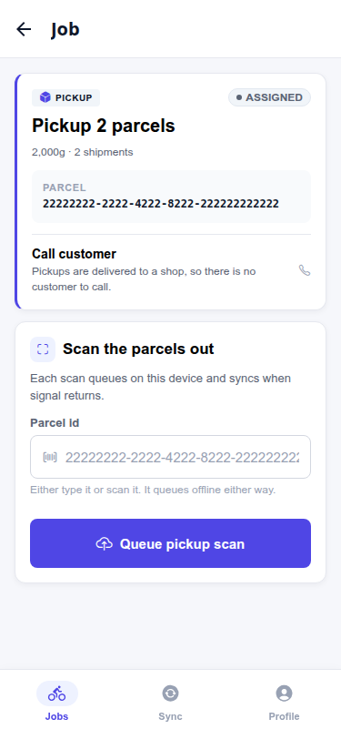</td>
<td width="50%">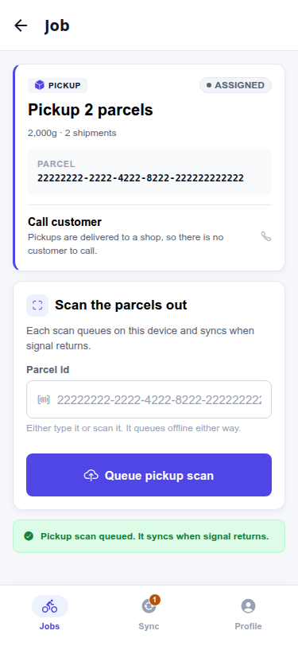</td>
</tr>
<tr>
<td align="center"><sub>A pickup batch</sub></td>
<td align="center"><sub>Queued offline, confirmed with a sequence</sub></td>
</tr>

<tr>
<td width="50%">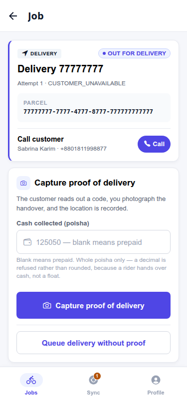</td>
<td width="50%"></td>
</tr>
<tr>
<td align="center"><sub>A delivery, with what to collect</sub></td>
<td align="center"><sub>A failed attempt, queued</sub></td>
</tr>

<tr>
<td width="50%">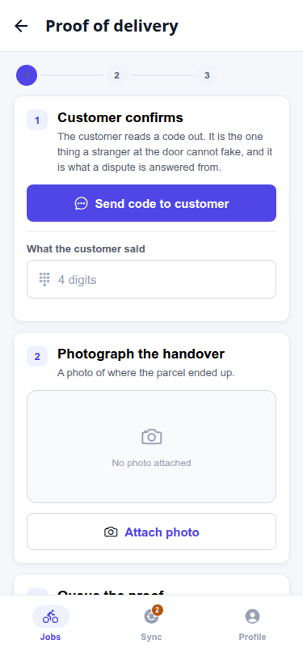</td>
<td width="50%"></td>
</tr>
<tr>
<td align="center"><sub>Proof capture, empty</sub></td>
<td align="center"><sub>Proof captured — the OTP, the photo, the location</sub></td>
</tr>

<tr>
<td width="50%">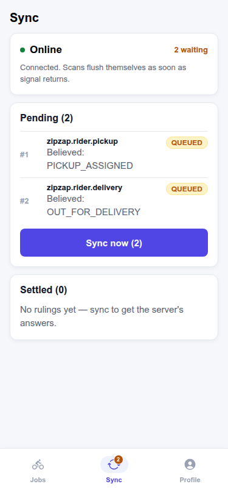</td>
<td width="50%"></td>
</tr>
<tr>
<td align="center"><sub>The queue, believed-state visible</sub></td>
<td align="center"><sub>Settled rulings, including ones that disagreed</sub></td>
</tr>

<tr>
<td width="50%">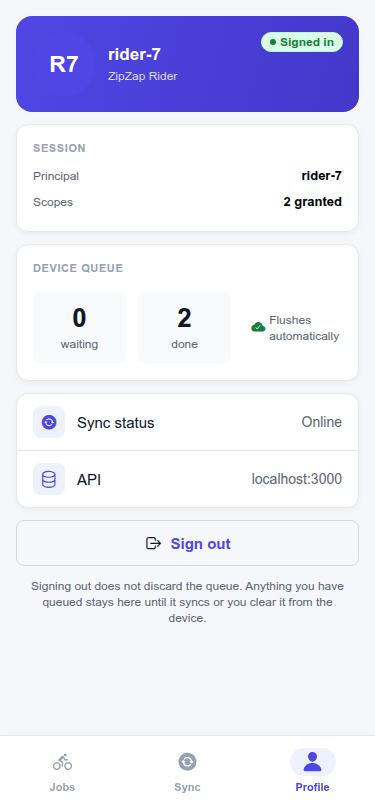</td>
<td width="50%"></td>
</tr>
<tr>
<td align="center"><sub>Session and queue summary</sub></td>
<td align="center"></td>
</tr>

### 📚 Documentation site — 4 shots

<tr>
<td width="50%"></td>
<td width="50%"></td>
</tr>
<tr>
<td align="center"><sub>Catalog index across six guides</sub></td>
<td align="center"><sub>The API reference, generated from the same spec as the client</sub></td>
</tr>

<tr>
<td width="50%">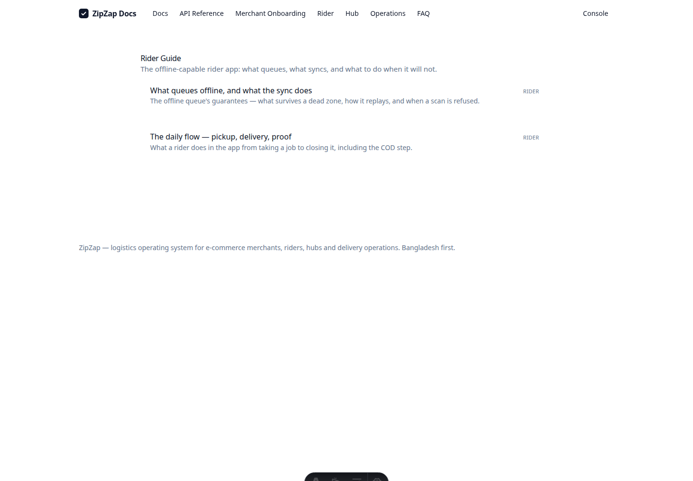</td>
<td width="50%"></td>
</tr>
<tr>
<td align="center"><sub>The rider guide</sub></td>
<td align="center"><sub>Getting started, with idempotency explained</sub></td>
</tr>

---

## 📄 Licence

[CC BY-NC-ND 4.0](LICENSE) — read it, run it, learn from it, cite it with attribution.

**You may not use it commercially, and you may not redistribute a modified version.** That second
part is deliberate: this repository exists to demonstrate how I build systems, and the
demonstration is the authorship. If you want to build from these ideas, the architecture and its
reasoning are documented in [`docs/`](docs/) — build your own, tell me about it, and I will be
genuinely pleased.

Looking for a licence that allows modifications while still barring commercial use?
**CC BY-NC 4.0** is the one to ask for.

<div align="center">

<br/>

**⚡ ZipZap** · _The logistics layer your e-commerce runs on._

<sub>Cash-on-delivery first · integer minor units, always</sub>

</div>
